# Accounting Agent — Architecture

Codes a company's Slash and Mercury transactions to QuickBooks accounts, explains why, asks the owner when unsure, and learns rules so a question is never asked twice. Written 2026-11-19 from the build brief. Generated blocks (`<!-- gen:* -->`) come from `src/lib/commands.ts`, `processes.yaml` and the Drizzle schema; run `pnpm arch` to refresh and `pnpm arch:check` before a PR.

## 1. Interface contract

### Launch & access

| Item | Value |
|---|---|
| Run locally | `pnpm i && pnpm db:reset && pnpm db:seed && pnpm dev` (Postgres in-process via PGlite at `data/pglite`; no Docker) |
| Local URL | `http://localhost:5173` → `/queue` |
| Deployed URL | `https://laceluxx-books.fly.dev` (Fly.io iad + Neon Postgres; first deploy in M9 step 5) |
| Auth | Google sign-in, invite-only (Workspace accounts; Auth.js at `/auth/*`). Locally with no `AUTH_GOOGLE_ID`: dev bypass, you are `owner@local` (refused in production). CLI: `BOOKS_TOKEN` from Settings → Members (`Authorization: Bearer llx_…`). First owner of a deployment: `pnpm org:invite <google-email>` |
| Roles | viewer (read), reviewer (decide on entries), owner (ledgers, switches, members, tokens) — per command in the registry, enforced in `handle()` |
| First screen | `/queue`: entries needing review, newest first, recommendation + confidence + Approve per row |
| CLI | `pnpm books --help` (dev) · `node dist/books.mjs` (built) |

### Route map

| Route | Screen | Reached from | Data (endpoint) | Mockup |
|---|---|---|---|---|
| `/queue` | Review queue (filters: recommended, asked, invalid, sending, ready) | Launch, nav | `GET /api/entries` | canvas `Main`, `States` |
| `/entry/[id]` | Entry detail: evidence, recommendation, edit splits, ask, reject | Queue row | `GET /api/entries/:id`, `GET /api/coa` | canvas `Entry` |
| `/questions` | Open + answered owner questions | Nav, Ask | `GET /api/questions` | follows `Entry` layout shell |
| `/mappings` | Learned rules to apply in Slash | Nav | `GET /api/mappings` | follows `Main` table |
| `/evals` | Eval results, shadow precision, cost by week | Nav | `GET /api/evals` | follows `Main` table |
| `/settings` | Connections, COA pull, payout CSV upload | Nav | `GET /api/settings` | follows `Entry` cards |
| `/system` | Control-plane graph + selected component | Nav | `GET /api/system/graph`, `GET /api/system/components` | canvas `System` |
| `/system/agents` | Agents & processes with switches | System tabs | `GET /api/system/components` | follows `Main` table |
| `/system/tools` | Tools by external system | System tabs | `GET /api/system/components?kind=tool` | follows `Entry` cards |
| `/system/processes/[id]` | Card, live state graph, runs | Graph node, tables | `GET /api/system/components/:id` | follows `Entry` layout |
| `/ledgers` | Ledger connections: capabilities, blockers, test, activate, configure bank mapping, add | Nav | `GET /api/ledgers`, `GET /api/ledgers/:id` | canvas `Ledgers` |
| `/login` | Sign in with Google; "isn't invited" state | Any route when signed out | Auth.js `/auth/signin/google` | canvas `Members` (login panel) |
| `/settings/members` | Members + pending invites (role, last seen), invite, change role, remove; API tokens (shown once, revoke) | Nav (owners) | `GET /api/members`, `GET /api/tokens` | canvas `Members` |
| Nav company switcher | Companies you belong to; switching reloads in that company | Every screen (hidden with one company) | `GET /api/orgs`, `POST /api/orgs/:id/select` | canvas `Members` (header) |

Designed mockups: Claude design canvas "Accounting Agent screens". The v2 dark artboards (`Tokens`, `Queue v2`, `Entry v2`, `System v2`, `Login v2`) are the current design; the earlier light artboards (`Main`, `Entry`, `States`, `System`, `Ledgers`, `Members`) remain for layout and states. Screenshots of the built screens: `docs/media/` (regenerate with `pnpm shots` and `pnpm gifs`). Every screen has empty, loading (skeleton / progress bar), error (source-tagged: Slash, QuickBooks, Model, with Retry), partial (invalid rows red, rest usable) and success states.

### Actions
<!-- gen:actions -->
| Action | Screen | Shortcut | Calls | Feedback ≤ 100 ms | Confirm / undo |
|---|---|---|---|---|---|
| Pull entries in review from Slash, then research and recommend | `/queue` | `p` | `POST /api/entries/pull` | Spinner on button | — |
| Research and recommend one entry | `/entry/[id]` | `R` | `POST /api/entries/:id/recommend` | Spinner | — |
| Approve: code the entry in Slash and mark it ready to sync | `/queue` | `a` | `POST /api/entries/:id/approve` | Row fades, toast with Undo | Undo for 10 s |
| Undo an approval still inside its undo window | `/queue` | `u` | `POST /api/entries/:id/undo` | Row returns | — |
| Open a question for the owner | `/entry/[id]` | `q` | `POST /api/entries/:id/ask` | Toast | — |
| Reject the recommendation; the entry is coded by hand in Slash | `/entry/[id]` | `x` | `POST /api/entries/:id/reject` | Toast | Requires --yes |
| Answer a question; the entry is re-recommended with the answer | `/questions` | `Enter` | `POST /api/questions/:id/answer` | Row moves to answered | — |
| Write a learned rule to Slash (recodes entries still in review) | `/mappings` | `r` | `POST /api/mappings/:id/apply` | Spinner | Confirm dialog |
| Pull the chart of accounts (Slash account dimension) | `/settings` | — | `POST /api/coa/pull` | Spinner | — |
| Import a Whatnot payout CSV | `/settings` | — | `POST /api/payouts/import` | Spinner | — |
| Run the eval cases (exit 1 if any fail) | `/evals` | `v` | `POST /api/evals/run` | Progress bar | — |
| Turn a decided entry into a golden eval case | `/entry/[id]` | — | `POST /api/evals/cases` | Toast | — |
| Add a ledger connection (starts inactive) | `/ledgers` | — | `POST /api/ledgers` | Panel closes, row appears | Bank-feed checkbox required for QuickBooks-direct ledgers |
| Update bank-account mapping or bank-feed confirmation | `/ledgers` | — | `POST /api/ledgers/:id/config` | Saved toast | — |
| Test a connection with its stored credentials | `/ledgers` | — | `POST /api/ledgers/:id/test` | Spinner, then ok/failed badge | — |
| Activate a connection (pulled hourly, approvals allowed) | `/ledgers` | — | `POST /api/ledgers/:id/state` | Status flips | Refused with the blockers listed |
| Deactivate a connection (not pulled, no approvals; items stay visible) | `/ledgers` | — | `POST /api/ledgers/:id/state` | Status flips | — |
| Switch a component on | `/system/agents` | `t` | `POST /api/system/components/:id/state` | Switch flips, node recolors | — |
| Switch a component off (its whenOff behavior applies) | `/system/agents` | `t` | `POST /api/system/components/:id/state` | Switch flips, node recolors | Confirm dialog naming the whenOff behavior |
| Invite a Google email with a role (accepted on first sign-in) | `/settings/members` | — | `POST /api/members/invite` | Row appears as pending | — |
| Change a member's role (the last owner can't be demoted) | `/settings/members` | — | `POST /api/members/:id/role` | Select updates | — |
| Remove a member or cancel an invite (the last owner can't be removed) | `/settings/members` | — | `POST /api/members/:id/remove` | Row disappears | Requires --yes |
| Create an API token for the CLI (shown once) | `/settings/members` | — | `POST /api/tokens` | Token shown once with Copy | — |
| Revoke an API token (next request with it gets 401) | `/settings/members` | — | `POST /api/tokens/:id/revoke` | Row greys out | Requires --yes |
| Switch the current company (web session) | `/queue` | — | `POST /api/orgs/:id/select` | Page reloads in that company | — |
| Command palette | everywhere | `⌘K` | any registry command | opens instantly | — |
<!-- /gen:actions -->

Queue keyboard: `j`/`k` move, `a` approve, `Enter` open, `p` pull, `u` undo. Entry: `a` approve, `e` save edits & approve, `q` ask, `x` reject, `Esc` back.

### CLI (`books <noun> <verb> [args] [flags]`)
<!-- gen:cli -->
| Command | Args / flags | Does | Role | Exit codes | Calls | Process |
|---|---|---|---|---|---|---|
| `books entries pull` | `--since` `--connection` `--dry-run` `--json` | Pull entries in review from Slash, then research and recommend | reviewer | 0 · 1 · 2 | `POST /api/entries/pull` | `MW.ledger.pull` |
| `books entries list` | `--state` `--connection` `--json` | List local entries | viewer | 0 · 1 · 2 | `GET /api/entries` | `FE.entries.list` |
| `books entry show` | `<id>` `--json` | Show one entry with evidence and decisions | viewer | 0 · 1 · 2 | `GET /api/entries/:id` | `FE.entries.list` |
| `books entry recommend` | `<id>` `--force` `--json` | Research and recommend one entry | reviewer | 0 · 1 · 2 | `POST /api/entries/:id/recommend` | `AI.entry.recommend` |
| `books entry approve` | `<id>` `--yes` `--dry-run` `--override` `--lines` `--memo` `--later` `--json` | Approve: code the entry in Slash and mark it ready to sync | reviewer | 0 · 1 · 2 | `POST /api/entries/:id/approve` | `FE.entry.approve` |
| `books entry undo` | `<id>` `--json` | Undo an approval still inside its undo window | reviewer | 0 · 1 · 2 | `POST /api/entries/:id/undo` | `FE.entry.undo` |
| `books entry ask` | `<id>` `--text` `--json` | Open a question for the owner | reviewer | 0 · 1 · 2 | `POST /api/entries/:id/ask` | `FE.entry.ask` |
| `books entry reject` | `<id>` `--yes` `--reason` `--json` | Reject the recommendation; the entry is coded by hand in Slash | reviewer | 0 · 1 · 2 | `POST /api/entries/:id/reject` | `FE.entry.reject` |
| `books questions list` | `--status` `--json` | List questions for the owner | viewer | 0 · 1 · 2 | `GET /api/questions` | `FE.questions.list` |
| `books question answer` | `<id>` `--text` `--json` | Answer a question; the entry is re-recommended with the answer | reviewer | 0 · 1 · 2 | `POST /api/questions/:id/answer` | `FE.question.answer` |
| `books mappings list` | `--status` `--json` | List learned rules | viewer | 0 · 1 · 2 | `GET /api/mappings` | `FE.mappings.list` |
| `books mapping apply` | `<id>` `--yes` `--dry-run` `--json` | Write a learned rule to Slash (recodes entries still in review) | owner | 0 · 1 · 2 | `POST /api/mappings/:id/apply` | `FE.mapping.apply` |
| `books coa pull` | `--dry-run` `--json` | Pull the chart of accounts (Slash account dimension) | owner | 0 · 1 · 2 | `POST /api/coa/pull` | `MW.coa.pull` |
| `books coa list` | `--json` | List accounts from the local chart of accounts | viewer | 0 · 1 · 2 | `GET /api/coa` | `FE.coa.list` |
| `books payouts import` | `<file>` `--channel` `--json` | Import a Whatnot payout CSV | reviewer | 0 · 1 · 2 | `POST /api/payouts/import` | `MW.payouts.import` |
| `books evals run` | `--json` | Run the eval cases (exit 1 if any fail) | reviewer | 0 · 1 · 2 | `POST /api/evals/run` | `IN.evals.run` |
| `books evals show` | `--json` | Show the last eval run, shadow precision and cost by week | viewer | 0 · 1 · 2 | `GET /api/evals` | `FE.evals.show` |
| `books eval add` | `<entry>` `--json` | Turn a decided entry into a golden eval case | reviewer | 0 · 1 · 2 | `POST /api/evals/cases` | `FE.eval.add` |
| `books ledgers list` | `--json` | List ledger connections (Slash, Mercury, …) with capabilities and status | viewer | 0 · 1 · 2 | `GET /api/ledgers` | `FE.ledgers.list` |
| `books ledger show` | `<id>` `--json` | Show one connection: capabilities, blockers, ledger and QuickBooks bank accounts | viewer | 0 · 1 · 2 | `GET /api/ledgers/:id` | `FE.ledgers.list` |
| `books ledger add` | `--kind` `--name` `--mode` `--token-stdin` `--qbo-bank` `--confirm-bank-feed` `--json` | Add a ledger connection (starts inactive) | owner | 0 · 1 · 2 | `POST /api/ledgers` | `FE.ledger.add` |
| `books ledger configure` | `<id>` `--qbo-bank` `--confirm-bank-feed` `--json` | Update bank-account mapping or bank-feed confirmation | owner | 0 · 1 · 2 | `POST /api/ledgers/:id/config` | `FE.ledger.add` |
| `books ledger test` | `<id>` `--json` | Test a connection with its stored credentials | owner | 0 · 1 · 2 | `POST /api/ledgers/:id/test` | `MW.ledger.test` |
| `books ledger enable` | `<id>` `--json` | Activate a connection (pulled hourly, approvals allowed) | owner | 0 · 1 · 2 | `POST /api/ledgers/:id/state` | `FE.ledger.toggle` |
| `books ledger disable` | `<id>` `--json` | Deactivate a connection (not pulled, no approvals; items stay visible) | owner | 0 · 1 · 2 | `POST /api/ledgers/:id/state` | `FE.ledger.toggle` |
| `books system graph` | `--json` | Show the component graph: agents, processes, tools, tables, external systems | viewer | 0 · 1 · 2 | `GET /api/system/graph` | `FE.system.graph` |
| `books components list` | `--kind` `--json` | List agents, processes and tools with on/off state and 7-day metrics | viewer | 0 · 1 · 2 | `GET /api/system/components` | `FE.system.graph` |
| `books component show` | `<id>` `--json` | Show one component: card, live state graph, recent runs | viewer | 0 · 1 · 2 | `GET /api/system/components/:id` | `FE.system.graph` |
| `books component enable` | `<id>` `--json` | Switch a component on | owner | 0 · 1 · 2 | `POST /api/system/components/:id/state` | `FE.component.toggle` |
| `books component disable` | `<id>` `--json` | Switch a component off (its whenOff behavior applies) | owner | 0 · 1 · 2 | `POST /api/system/components/:id/state` | `FE.component.toggle` |
| `books settings show` | `--json` | Show connections and configuration | viewer | 0 · 1 · 2 | `GET /api/settings` | `FE.settings.show` |
| `books auth whoami` | `--json` | Who am I: email, company and role | viewer | 0 · 1 · 2 | `GET /api/auth/whoami` | `FE.auth.whoami` |
| `books members list` | `--json` | List members and pending invites of this company | owner | 0 · 1 · 2 | `GET /api/members` | `FE.members.list` |
| `books member invite` | `--email` `--role` `--json` | Invite a Google email with a role (accepted on first sign-in) | owner | 0 · 1 · 2 | `POST /api/members/invite` | `FE.member.invite` |
| `books member role` | `<id>` `--role` `--json` | Change a member's role (the last owner can't be demoted) | owner | 0 · 1 · 2 | `POST /api/members/:id/role` | `FE.member.role` |
| `books member remove` | `<id>` `--yes` `--json` | Remove a member or cancel an invite (the last owner can't be removed) | owner | 0 · 1 · 2 | `POST /api/members/:id/remove` | `FE.member.remove` |
| `books tokens list` | `--json` | List API tokens of this company | owner | 0 · 1 · 2 | `GET /api/tokens` | `FE.tokens.list` |
| `books token create` | `--name` `--json` | Create an API token for the CLI (shown once) | owner | 0 · 1 · 2 | `POST /api/tokens` | `FE.token.create` |
| `books token revoke` | `<id>` `--yes` `--json` | Revoke an API token (next request with it gets 401) | owner | 0 · 1 · 2 | `POST /api/tokens/:id/revoke` | `FE.token.revoke` |
| `books orgs list` | `--json` | List the companies you belong to | viewer | 0 · 1 · 2 | `GET /api/orgs` | `FE.orgs.list` |
| `books org select` | `<id>` `--json` | Switch the current company (web session) | viewer | 0 · 1 · 2 | `POST /api/orgs/:id/select` | `FE.org.select` |
<!-- /gen:cli -->

Rules: data → stdout, logs → stderr; `--json` returns the API schema; exit 0 ok · 1 user error (HTTP 4xx) · 2 upstream/system error (HTTP 5xx, server unreachable). Every Slash write needs `--yes` and supports `--dry-run`. `--help` is generated from the registry.

```
$ books entries pull --since 2026-11-01
Pulled 23 entries in review (Slash) · 4 new merchants · 23 recommended
$ books entry approve ae_0051
error: books entry approve writes to Slash; pass --yes to confirm or --dry-run to preview      (exit 1)
$ books entry approve ae_0051 --yes
error: The recommendation is a question, not a coding; answer it or pass --lines              (exit 1)
$ books entry approve ae_0050 --yes
Coded ae_0050 → Shipping & Postage · marked ready to sync
```

### Design system

Brief: `docs/design/brief.md`. One stylesheet, `src/app.css`, holds every token; screens only reference tokens.

| Part | Rule |
|---|---|
| Surfaces | Four layered "ink" levels (page, panel, raised, overlay) with hairline outlines; depth from layering, not heavy shadows |
| Accent | One indigo→violet gradient, used only for the primary action, active nav item, focus and the confidence meter |
| Status | Mint = money in / passed, amber = needs you, rose = failed |
| Type | Inter Variable (interface) and JetBrains Mono (amounts, ids), self-hosted; tabular numerals for money |
| Themes | Dark by default; light via `data-theme="light"` (toggle in the nav, remembered in `localStorage`) |
| Motion | 120–180 ms, only in response to an action; off under `prefers-reduced-motion` |
| Shared classes | `.btn` (+ `primary`, `ghost`, `danger`, `sm`), `.chip`, `.card`, `.badge`, `.pill`, `.meter`, `.avatar`, `.kbd`, `.skeleton`, `.page-head`, `.section-title`, `.stat-tile`, `.empty-state`, `.dialog` — a screen adds layout, not new control styles |
| Names | `src/lib/names.ts` gives every process and tool a plain-language name ("Recommend coding"); the technical id stays the key and is shown beside it |

### Screen flow

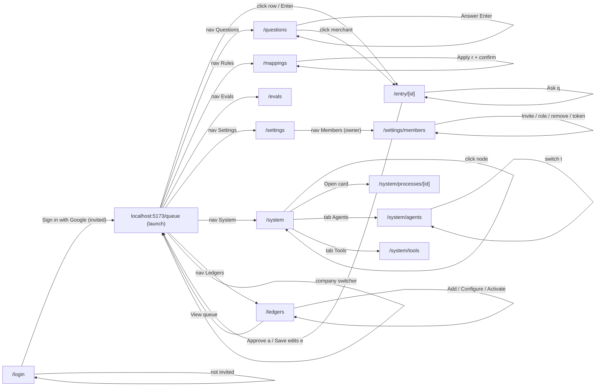

## 2. Systems architecture

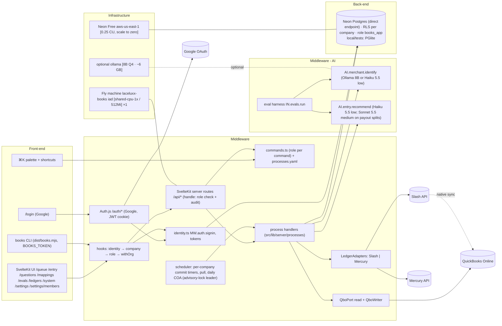

Products and what they use:

| Product / feature | Components | Tables owned | Models / agents |
|---|---|---|---|
| Review queue | UI `/queue`, `MW.ledger.pull`, `MW.entry.research`, `FE.entry.approve`, `MW.ledger.code`, `MW.ledger.ready` | `ledger_items`, `ledger_transactions`, `evidence`, `decisions` | `AI.entry.recommend` (Haiku 5.5 low) |
| Unknown merchants | `MW.entry.research` | `evidence` | `AI.merchant.identify` (Ollama or Haiku 5.5 low) |
| Owner questions | UI `/questions`, `FE.entry.ask`, `FE.question.answer` | `questions` | re-runs `AI.entry.recommend` |
| Payout splits | `MW.payouts.import` | `payout_rows` | `AI.entry.recommend` (Sonnet 5.5 medium) |
| Learned rules | `MW.mapping.propose`, `FE.mapping.apply` | `mapping_proposals` | none (Tier 0; replaces model calls) |
| Evals & precision | `IN.evals.run`, `/evals` | `eval_cases`, `runs` | both AI steps |
| QuickBooks connect | `MW.qbo.connect` | `qbo_tokens` | none |
| Ledger connections | `/ledgers`, adapters, `MW.qbo.write` | `ledger_connections`, `ledger_items`, `ledger_transactions`, `local_mappings` | none |
| Companies (tenancy) | `MW.org.create`, hooks, `withOrg`, RLS | `orgs` (+ `org_id` on every tenant table) | none |
| Sign-in & members | `/login`, `MW.auth.signin`, `/settings/members`, `FE.member.*`, `FE.token.*`, `FE.org.select` | `users`, `memberships`, `invites`, `api_tokens` | none |
| Audit | `MW.audit.record` (in `handle()`) | `audit_log` | none |

**Key decision — the ledger's own sync is the write path when it has one.** Slash creates an accounting entry per settled transaction and syncs it to QuickBooks, so Slash items are coded in Slash and the app never writes QuickBooks for them. Ledgers that can't code for QuickBooks (Mercury) are written to QuickBooks directly under the guardrail in §4c.

### Backend ERD
<!-- gen:erd -->
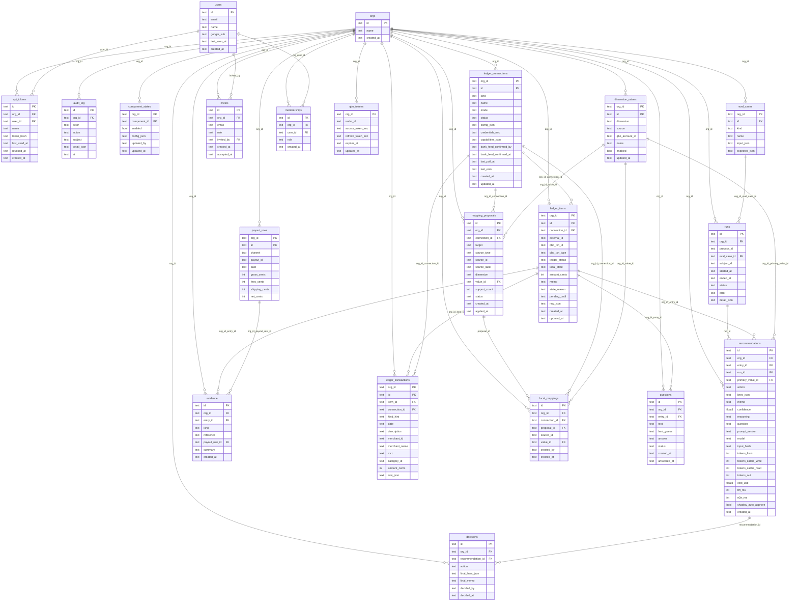
<!-- /gen:erd -->

## 3. Sequence diagrams

### Routine expense (with undo window)

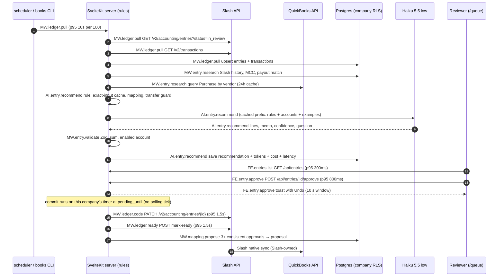

### Unknown merchant

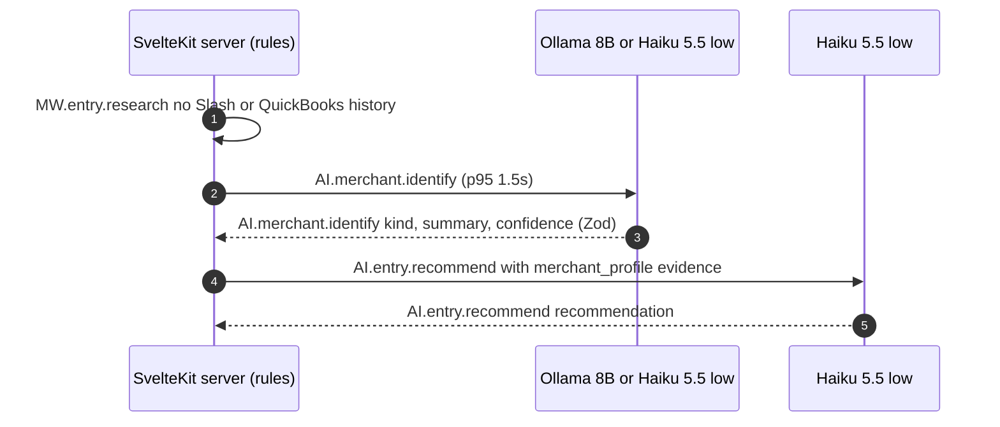

### Owner question

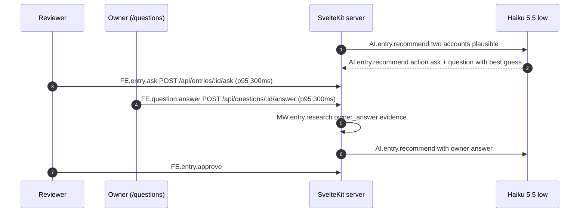

### Whatnot payout

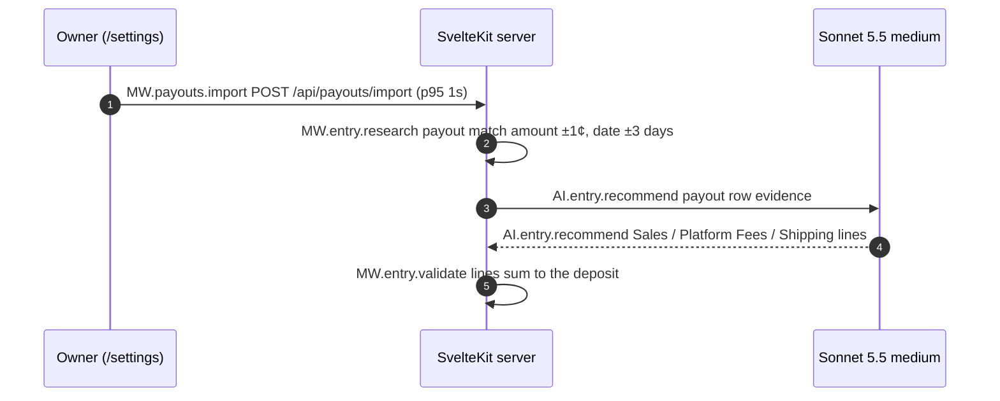

### Learn a rule


### Degraded: model down

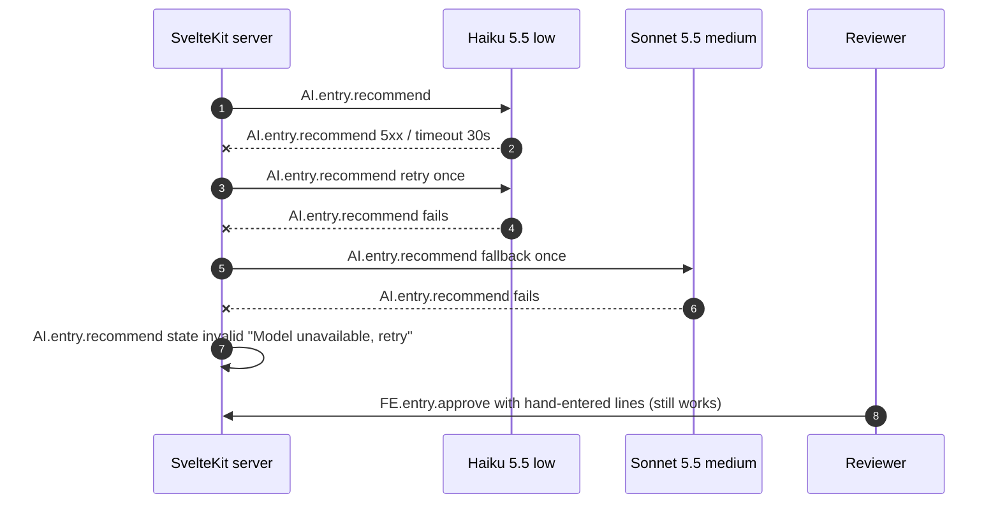

### Accounting entry state

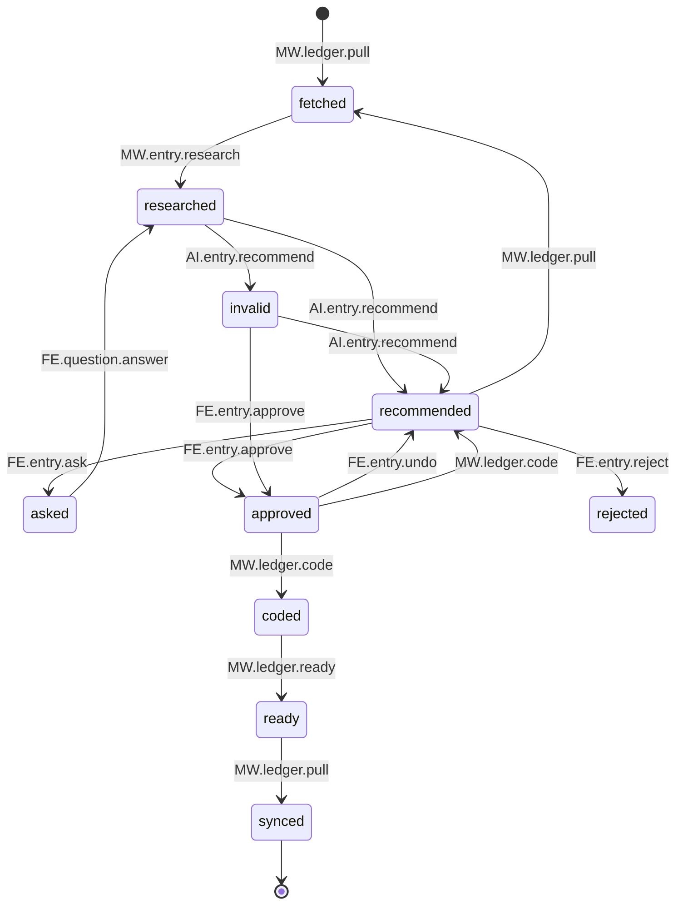

## 4. State and process directory

State cards (table → writers):
<!-- gen:states -->
| Component (table) | Written by |
|---|---|
| `api_tokens` | `FE.member.remove`, `FE.token.create`, `FE.token.revoke` |
| `audit_log` | `MW.audit.record` |
| `component_states` | `FE.component.toggle` |
| `decisions` | `FE.entry.approve`, `FE.entry.undo`, `FE.entry.ask`, `FE.entry.reject` |
| `dimension_values` | `MW.coa.pull`, `MW.qbo.accounts` |
| `eval_cases` | `FE.eval.add`, `MW.org.create` |
| `evidence` | `MW.entry.research`, `AI.merchant.identify`, `FE.question.answer` |
| `invites` | `MW.auth.signin`, `FE.member.invite`, `FE.member.role`, `FE.member.remove` |
| `ledger_connections` | `MW.ledger.pull`, `FE.ledger.add`, `FE.ledger.toggle`, `MW.org.create` |
| `ledger_items` | `MW.ledger.pull`, `MW.entry.research`, `AI.entry.recommend`, `FE.entry.approve`, `FE.entry.undo`, `MW.ledger.code`, `MW.ledger.ready`, `FE.entry.ask`, `FE.entry.reject`, `FE.question.answer`, `MW.qbo.write` |
| `ledger_transactions` | `MW.ledger.pull` |
| `local_mappings` | `FE.mapping.apply` |
| `mapping_proposals` | `MW.mapping.propose`, `FE.mapping.apply` |
| `memberships` | `MW.auth.signin`, `FE.member.invite`, `FE.member.role`, `FE.member.remove` |
| `orgs` | `MW.org.create` |
| `payout_rows` | `MW.payouts.import` |
| `qbo_tokens` | `MW.qbo.connect` |
| `questions` | `FE.entry.ask`, `FE.question.answer` |
| `recommendations` | `AI.entry.recommend` |
| `runs` | `IN.evals.run` |
| `users` | `MW.auth.signin` |
<!-- /gen:states -->

`accounting_entries` invariants: lines sum to the transaction amount; local state never goes ahead of Slash status; nothing is written to Slash without a recorded human decision; an approved entry is written only after `pending_until`.

Other multi-state components: `questions` (open → answered, `FE.question.answer`), `mapping_proposals` (proposed → applied by `FE.mapping.apply`, or → dismissed by `MW.mapping.propose` on conflict).

### Process cards
<!-- gen:processes -->
| ID | Trigger | Input | Processing | Output | Fails as | Accept | Budget (p95 · $/run) |
|---|---|---|---|---|---|---|---|
| `MW.coa.pull` | Daily scheduler, `books coa pull`, first pull | Slash account dimension values (SlashDimensionValue[]) | **rule**: upsert account values per chart source: Slash dimension values ('slash'); QuickBooks accounts via MW.qbo.accounts ('qbo') when any connection codes qbo_direct | dimension_values rows → CoaPull | 2: Slash error (key missing, no account dimension, 5xx after retries) | tests/m1-pull.test.ts — 11 accounts, disabled flag kept | 2000 ms · $0 |
| `MW.ledger.pull` | Hourly (PULL_INTERVAL_MIN), `books entries pull [--connection]`, Pull button | { since?, dryRun?, connectionId? } + per active connection: adapter.listItems + listHistory (normalized LedgerItem) | **rule**: for each active ledger connection: list items in review + history through its adapter<br>**rule**: upsert by (connection, external id); changed raw (e.g. mapping recode) → back to fetched; ready→synced<br>**rule**: queue research → recommend for new/changed items; a failing connection is recorded, others continue | PullResult; ledger_items fetched, ledger_transactions | 2: Slash 429/5xx after 5 tries with jitter; run marked failed | tests/m1-pull.test.ts — 23 in → 23 rows, rerun idempotent | 10000 ms · $0 |
| `MW.entry.research` | After pull, after an owner answer, payout import | accounting entry + transaction; payout_rows; QuickBooks vendors/purchases | **rule**: Slash history by merchant id (or normalized description)<br>**rule**: QuickBooks purchases by vendor name, trigram ≥ 0.6<br>**rule**: MCC table lookup<br>**rule**: payout match: amount ± $0.01, date ± 3 days<br>**rule**: no history + card merchant → AI.merchant.identify | evidence rows; state researched | Partial: missing source noted in state_reason; continues | tests/m2-recommend.test.ts — USPS evidence kinds, QuickBooks-down partial | 1500 ms · $0 |
| `AI.merchant.identify` | Research found no Slash or QuickBooks history | { merchantName, mcc, description } | **rule**: build prompt identify.v1<br>**judgment** (Ollama 8B if OLLAMA_URL else Haiku 5.5 low): classify merchant kind<br>**rule**: Zod; failure → unknown | evidence(kind=merchant_profile) | Schema fail or model down → kind unknown, confidence 0 | Fixture identify table; live: ≥ 8/10 merchant fixtures (TBD — add 10 cases) | 1500 ms · $0.0003 |
| `AI.entry.recommend` | After research; `books entry recommend`; Recommend again | RecInput { transaction{description, amountCents, mcc, kind}, evidence[], ownerAnswers[] } + enabled accounts | **rule**: exact-input cache: unchanged hash → reuse stored output<br>**rule**: Slash mapping precoded → code it (rules:mapping)<br>**rule**: own transfer / person payment without owner answer → ask (rules:guard)<br>**judgment** (Haiku 5.5 low; Sonnet 5.5 medium when a payout row matched): account, lines, memo, confidence, question<br>**rule**: Zod; 1 retry; fallback to Sonnet once; then invalid<br>**rule**: MW.entry.validate | recommendations row (tokens, cost, ttft, e2e); state recommended \| invalid | Model down after retry + fallback → invalid 'Model unavailable, retry' | 6/6 seed eval cases; ≥ 95% shadow precision on first 100 decisions | 4000 ms · $0.0005 |
| `MW.entry.validate` | After every recommendation and every approval | RecOutput + { amountCents, enabled accounts, tx kind, hasOwnerAnswer } | **rule**: sum = amount, accounts enabled, integer cents, ask has question, never code transfers | error list (empty = valid) | — | tests/rules.test.ts | 5 ms · $0 |
| `FE.entry.approve` | Button a / Save edits e, `books entry approve <id> --yes` | entry id, optional edited lines + memo, override, later | **rule**: no open question (unless override); state recommended/invalid; validate lines<br>**human**: decision recorded with who and when (approved \| edited)<br>**rule**: later: hold for the undo window (pending_until); else commit now | Decision; state approved | 1: open question, bad state, invalid lines | tests/m3-write.test.ts, tests/e2e/queue.spec.ts | 800 ms · $0 |
| `FE.entry.undo` | Undo in toast (u), `books entry undo <id>` | entry id inside its undo window | **human**: undone decision recorded; state back to recommended | Decision; state recommended | 1: window closed (already sending) | tests/m3-write.test.ts — no Slash write after undo | 300 ms · $0 |
| `MW.ledger.code` | Commit tick after the undo window, or approve without --later | latest decision lines | **rule**: capabilities.code = 'ledger': adapter.code (Slash PATCH entry: dimensions or lineItems), idempotency key = decision:code | state coded | 409 sync in progress → retry in 60 s; 400 → recommended with error | tests/m3-write.test.ts | 1500 ms · $0 |
| `MW.ledger.ready` | After MW.ledger.code | entry id | **rule**: adapter.markReady (Slash mark-ready), idempotency key = decision:ready | state ready (Slash ready_to_sync) | Error surfaced on the row; stays coded | tests/m3-write.test.ts | 1500 ms · $0 |
| `FE.entry.ask` | Ask (q), `books entry ask <id>` | entry id, optional question text (defaults to the recommendation's) | **human**: question recorded; decision asked | Question; state asked | 1: already asked, bad state | tests/m3-write.test.ts | 300 ms · $0 |
| `FE.entry.reject` | Reject (x) + confirm, `books entry reject <id> --yes` | entry id, optional reason | **human**: rejected decision recorded; coded by hand in Slash | Decision; state rejected | 1: no --yes, bad state | tests/m3-write.test.ts | 300 ms · $0 |
| `FE.question.answer` | Questions screen Enter, `books question answer <id> --text` | question id, answer text | **human**: answer recorded as evidence(owner_answer)<br>**rule**: queue research → recommend | Question answered; state researched | 1: empty answer, already answered | tests/m3-write.test.ts | 300 ms · $0 |
| `MW.mapping.propose` | After every approve or undo | latest decision per entry for the merchant | **rule**: ≥ 3 approvals of a merchant to the same single account within one connection, 0 conflicts → proposal (target = ledger \| local by capability); conflict → dismiss | mapping_proposals row | — | tests/m4-learn.test.ts | 50 ms · $0 |
| `FE.mapping.apply` | Rules screen Apply + confirm, `books mapping apply <id> --yes` | proposal id | **human**: confirm<br>**rule**: target 'ledger': adapter.upsertMapping (Slash PUT /v2/accounting/mappings) then pull; target 'local': local_mappings row, re-recommend waiting entries | proposal applied | 1: no --yes; 2: Slash error | tests/m4-learn.test.ts — next USPS entry coded by rules:mapping, no model call | 1500 ms · $0 |
| `MW.payouts.import` | Settings upload, `books payouts import <csv>` | CSV payout_id,date,gross,fees,shipping,net | **rule**: parse + validate (gross − fees − shipping = net ± 1¢)<br>**rule**: upsert; re-research credits waiting for review | payout_rows | 1: bad CSV with line numbers | tests/rules.test.ts, tests/m2-recommend.test.ts | 1000 ms · $0 |
| `IN.evals.run` | `books evals run`, Evals screen (v), CI | eval_cases | **rule**: replay AI.merchant.identify + AI.entry.recommend per case, score against expected | EvalRun; runs rows per case | 1: any case fails | 6/6 seed | 30000 ms · $0.005 |
| `FE.eval.add` | Entry screen 'Add as eval case', `books eval add <entry>` | entry with an approved decision | **human**: freeze current input + human lines as a golden case | eval_cases row | 1: no approved decision | manual | 100 ms · $0 |
| `MW.qbo.connect` | Settings → Connect QuickBooks | Intuit OAuth 2.0 code + realmId | **rule**: exchange code, store encrypted tokens (rotating refresh) | qbo_tokens row | 400 state mismatch; 502 token exchange | TBD — sandbox test once QBO keys exist | 2000 ms · $0 |
| `FE.entries.list` | Queue / entry screens, `books entries list`, `books entry show` | state filter | **rule**: read model | Entry[] / EntryDetail | — | e2e | 300 ms · $0 |
| `FE.questions.list` | Questions screen, `books questions list` | status | **rule**: read model | Question[] | — | e2e | 300 ms · $0 |
| `FE.mappings.list` | Rules screen, `books mappings list` | status | **rule**: read model | MappingProposal[] | — | e2e | 300 ms · $0 |
| `FE.evals.show` | Evals screen, `books evals show` | — | **rule**: last run, shadow precision, cost by week | EvalSummary | — | manual | 300 ms · $0 |
| `FE.settings.show` | Settings screen, `books settings show` | — | **rule**: read config | Settings | — | manual | 100 ms · $0 |
| `FE.coa.list` | Entry screen account picker, `books coa list` | — | **rule**: read dimension_values | Account[] | — | e2e | 100 ms · $0 |
| `FE.system.graph` | /system screens, `books system graph`, `books components list`, `books component show` | registries (processes.yaml, commands.ts) + component_states + runs (7 days) | **rule**: join registry nodes with on/off state and 7-day metrics; derive edges from traces and tool usage | SystemGraph { nodes[], edges[] } / Component[] / ComponentDetail | — | tests/m6-control.test.ts | 100 ms · $0 |
| `FE.component.toggle` | /system toggle (t), `books component enable\|disable <id>` | component id (process or tool) + enabled | **rule**: reject components with toggle: false<br>**human**: state recorded with who and when | Component; component_states row | 1: component cannot be switched off / unknown id | tests/m6-control.test.ts, tests/e2e/system.spec.ts | 300 ms · $0 |
| `MW.qbo.write` | Commit after the undo window for a connection with capabilities.code = 'qbo_direct' (Mercury) | decision lines (qbo:<Id> values) + item + connection bank-account mapping | **rule**: map ledger account → QuickBooks bank account and qbo:<Id> → QuickBooks account<br>**rule**: dedupe: Purchase/Deposit on that bank, same amount, ±3 days, ignoring other LaceLuxx-written txns<br>**rule**: uncategorized match → sparse-update its lines; same account → no write; other account → entry invalid; none → create with requestid = decision id | ledger_items ready + qbo_txn_id/qbo_txn_type, or invalid/recommended with a QUICKBOOKS reason | QuickBooks 4xx/5xx → stays approved, retry in 60 s; missing mapping → recommended with reason; conflicting match → invalid | tests/m7-ledgers.test.ts — create once, idempotent rerun, uncategorized update, conflict → invalid, qbo.write off → held | 1500 ms · $0 |
| `MW.ledger.annotate` | After MW.qbo.write succeeds (optional) | entry + final account names | **rule**: adapter.annotate: Mercury PATCH /transaction/{id} note "Coded in QuickBooks by LaceLuxx Books: <account>" | note on the ledger transaction | Failure noted on the entry; QuickBooks coding stands | tests/m7-ledgers.test.ts | 1500 ms · $0 |
| `MW.qbo.accounts` | MW.coa.pull when any connection codes against QuickBooks | QuickBooks Account list | **rule**: expense/income/COGS/equity accounts become qbo:<Id> coding targets; bank and Uncategorized accounts disabled | dimension_values (source qbo) | 2: QuickBooks error | tests/m7-ledgers.test.ts | 2000 ms · $0 |
| `MW.ledger.test` | /ledgers Test, `books ledger test <id>` | connection id | **rule**: adapter.health(): list accounts with the stored credentials | LedgerDetail with health | health.ok = false with the adapter message | tests/m7-ledgers.test.ts | 2000 ms · $0 |
| `FE.ledger.add` | /ledgers Add connection, `books ledger add` | { kind, name, mode, token?, config (account → QuickBooks bank mapping), bankFeedConfirmed } | **human**: owner adds the connection and confirms the bank-feed setting (recorded with who and when); token stored AES-GCM encrypted | ledger_connections row (inactive) | 1: bad kind, missing token for live | tests/m7-ledgers.test.ts, tests/e2e/ledgers.spec.ts | 300 ms · $0 |
| `FE.ledger.toggle` | /ledgers Activate/Deactivate, `books ledger enable\|disable <id>` | connection id + active | **rule**: activation blockers: qbo_direct needs bank-feed confirmation + bank mapping; live Mercury needs a token<br>**human**: state change | connection status | 1: blockers listed | tests/m7-ledgers.test.ts | 300 ms · $0 |
| `FE.ledgers.list` | /ledgers, `books ledgers list`, `books ledger show` | — | **rule**: connections with capabilities, blockers, counts (never credentials) | LedgerConnection[] / LedgerDetail | — | e2e | 100 ms · $0 |
| `MW.org.create` | First boot (default org), `books orgs create` (M8 step 3), tests | { name: string, id?: org_<letters, digits, - or _> } | **rule**: validate name and id; insert orgs row as the owner role (orgs is global, no RLS)<br>**rule**: inside the new org's RLS context: default Slash connection (inactive) + a copy of the 9 seed eval cases | org id; orgs row, ledger_connections row, 9 eval_cases rows for that org | 1: bad name or id (400) | tests/m8-tenancy.test.ts — each new org gets its own 9 eval cases; org B sees none of A's rows | 300 ms · $0 |
| `MW.audit.record` | Every successful mutating API call (inside handle()) | { actor: user id \| token:<id> \| system, action: registry process id, subject: path :id, body } | **rule**: look up the registry command for route + method; redact keys matching token\|secret\|password\|key\|credential<br>**rule**: insert one audit_log row in the request's org (RLS) | audit_log row | 2: DB error → the request returns 500 (an unaudited write is not acceptable) | tests/m8-tenancy.test.ts — audit row per write, secrets redacted | 10 ms · $0 |
| `MW.auth.signin` | Google sign-in callback (Auth.js) | { email, name, Google sub, email_verified } | **rule**: refuse when no email, unverified, or no membership and no open invite<br>**rule**: create/update users (sub, name, last seen); accept every open invite for that email → memberships | true \| false (false → /login?error=AccessDenied) | refused → /login 'isn't invited' state | tests/m8-auth.test.ts — not invited refused; invite accepted on first sign-in | 150 ms · $0 |
| `FE.auth.whoami` | `books auth whoami`, layout load | identity resolved in hooks | **rule**: current company + role from the identity | Whoami | 401 when not signed in | tests/m8-auth.test.ts | 20 ms · $0 |
| `FE.members.list` | /settings/members, `books members list` | — | **rule**: memberships ⨝ users and open invites, RLS-scoped to the company | Member[] | 403 below owner | tests/m8-auth.test.ts | 50 ms · $0 |
| `FE.member.invite` | Invite form, `books member invite --email --role` | { email, role } | **rule**: validate email + role; refuse duplicates (409)<br>**rule**: existing app user → membership now; else open invite accepted on first sign-in | Member (invite or member) | 1: bad email/role, already a member | tests/m8-auth.test.ts | 80 ms · $0 |
| `FE.member.role` | Role select, `books member role <id> --role` | { id: mem_…\|inv_…, role } | **rule**: the company always keeps ≥ 1 owner (409 last_owner) | Member | 1: last owner, not found | tests/m8-auth.test.ts | 60 ms · $0 |
| `FE.member.remove` | Remove / Cancel invite, `books member remove <id> --yes` | { id, yes: true } | **rule**: require --yes; keep ≥ 1 owner; revoke the member's tokens for this company, then delete | Member (as it was) | 1: no --yes, last owner | tests/m8-auth.test.ts | 80 ms · $0 |
| `FE.tokens.list` | /settings/members, `books tokens list` | — | **rule**: tokens ⨝ users for this company (never the raw token) | ApiToken[] | 403 below owner | tests/m8-auth.test.ts | 40 ms · $0 |
| `FE.token.create` | New token, `books token create --name` | { name } + calling user (web session, not a token) | **rule**: 32 random bytes (llx_…); store sha256 only; return the raw token once | NewToken (token shown once) | 1: no name; 403 when called with a token | tests/m8-auth.test.ts | 60 ms · $0 |
| `FE.token.revoke` | Revoke, `books token revoke <id> --yes` | { id, yes: true } | **rule**: set revoked_at; the next request with it gets 401 | ApiToken | 1: no --yes, not found | tests/m8-auth.test.ts | 40 ms · $0 |
| `FE.orgs.list` | Nav company switcher, `books orgs list` | identity memberships | **rule**: companies the caller belongs to; mark the current one | Org[] | — | tests/m8-auth.test.ts | 20 ms · $0 |
| `FE.org.select` | Company switcher | { id: org_… } | **rule**: must be a member; tokens are pinned to their company<br>**rule**: set the books_org cookie; the next request runs in that company's RLS context | Org | 404 not a member; 403 with a token | tests/m8-auth.test.ts | 30 ms · $0 |
<!-- /gen:processes -->

### Interaction directory
<!-- gen:interactions -->
| From | To | Via | Sync | Payload | Timeout / retry / fallback |
|---|---|---|---|---|---|
| `MW.ledger.pull` | Slash API | HTTPS | sync | GET /v2/accounting/entries, /v2/transactions | 10 s; 5 tries, jittered backoff; run failed |
| `MW.coa.pull` | Slash API | HTTPS | sync | GET /v2/accounting/dimensions(+values) | 10 s; 5 tries |
| `MW.entry.research` | QuickBooks API | HTTPS | sync | query Vendor, Purchase (24 h cache) | 10 s; 2 tries; continue without QuickBooks evidence |
| `AI.merchant.identify` | Ollama | Anthropic | HTTP | sync | identify.v1 | 20 s; Ollama → Haiku |
| `AI.entry.recommend` | Anthropic | HTTPS | sync | recommend.v1 (cached prefix) | 30 s; 1 retry; Sonnet once; else invalid |
| `MW.ledger.code` | Slash API | HTTPS | sync | PATCH entry | 10 s; idempotency key = decision id |
| `MW.ledger.ready` | Slash API | HTTPS | sync | POST mark-ready | 10 s; idempotency key = decision id |
| `FE.mapping.apply` | Slash API | HTTPS | sync | PUT /v2/accounting/mappings | 10 s; idempotency key = proposal id |
| `MW.qbo.connect` | Intuit OAuth | HTTPS | sync | token exchange | 10 s; no retry |
| `MW.ledger.pull` | Mercury API | HTTPS | sync | GET /accounts, /transactions (cursor) | 10 s; 5 tries with jitter; connection lastError, others continue |
| `MW.qbo.write` | QuickBooks API | HTTPS | sync | query Purchase/Deposit; POST purchase\|deposit?requestid=decision | 10 s; on failure stays approved, retry in 60 s; requestid makes retries safe |
| `MW.ledger.annotate` | Mercury API | HTTPS | sync | PATCH /transaction/{id} note | 10 s; failure noted, coding stands |
<!-- /gen:interactions -->

### Use-case traces
<!-- gen:traces -->
| Use case | Actor | Trigger | Processes | End state |
|---|---|---|---|---|
| Routine expense | Cron, reviewer | Hourly pull | `MW.coa.pull` → `MW.ledger.pull` → `FE.entries.list` → `MW.entry.research` → `AI.entry.recommend` → `MW.entry.validate` → `FE.entry.approve` → `MW.ledger.code` → `MW.ledger.ready` → `MW.mapping.propose` | ready |
| Unknown merchant | Cron, reviewer | Hourly pull | `MW.ledger.pull` → `MW.entry.research` → `AI.merchant.identify` → `AI.entry.recommend` → `MW.entry.validate` → `FE.entry.approve` → `MW.ledger.code` → `MW.ledger.ready` | ready |
| Owner question | Reviewer, owner | Low confidence | `AI.entry.recommend` → `FE.entry.ask` → `FE.questions.list` → `FE.question.answer` → `MW.entry.research` → `AI.entry.recommend` → `FE.entry.approve` → `MW.ledger.code` → `MW.ledger.ready` | ready |
| Undo | Reviewer | Approve then Undo within 10 s | `FE.entry.approve` → `FE.entry.undo` → `MW.mapping.propose` | recommended |
| Reject | Reviewer | Wrong recommendation | `FE.entry.reject` | rejected |
| Whatnot payout | Owner, reviewer | Payout lands | `MW.payouts.import` → `MW.entry.research` → `AI.entry.recommend` → `MW.entry.validate` → `FE.entry.approve` → `MW.ledger.code` → `MW.ledger.ready` | ready |
| Learn a rule | Reviewer | 3rd consistent approval | `MW.mapping.propose` → `FE.mappings.list` → `FE.mapping.apply` → `MW.ledger.pull` → `AI.entry.recommend` | mapping in Slash; next entry coded by rules:mapping |
| Degraded: model down | Cron | Anthropic 5xx | `AI.entry.recommend` | invalid — 'Model unavailable, retry'; manual edit-and-approve still works |
| Evals | Reviewer, CI | `books evals run` | `IN.evals.run` → `AI.merchant.identify` → `AI.entry.recommend` → `FE.evals.show` → `FE.eval.add` | EvalRun |
| Setup | Owner | First run | `FE.settings.show` → `MW.qbo.connect` → `MW.coa.pull` → `FE.coa.list` | connected |
| Control plane | Owner | Review or pause a component | `FE.system.graph` → `FE.component.toggle` → `MW.ledger.pull` → `AI.entry.recommend` | component off → its whenOff behavior; on → normal |
| Mercury expense (QuickBooks direct) | Cron, reviewer | Hourly pull | `MW.ledger.pull` → `MW.coa.pull` → `MW.qbo.accounts` → `MW.entry.research` → `AI.entry.recommend` → `MW.entry.validate` → `FE.entry.approve` → `MW.qbo.write` → `MW.ledger.annotate` | ready (QuickBooks txn created, matched or recoded) |
| Connect a ledger | Owner | Add Mercury | `FE.ledgers.list` → `FE.ledger.add` → `MW.ledger.test` → `FE.ledger.toggle` → `MW.ledger.pull` | connection active, items pulled |
| New company | Owner (system on first boot) | Default org missing, or a new company is added | `MW.org.create` → `MW.coa.pull` → `FE.ledger.add` | org with its own connections, chart, switches and eval cases; invisible to other orgs (RLS) |
| Audited change | Owner, reviewer | Any write (approve, toggle, ledger change) | `FE.component.toggle` → `MW.audit.record` | audit_log row with actor, process id and redacted body |
| Invite a reviewer | Owner, new reviewer | Owner adds a bookkeeper | `FE.members.list` → `FE.member.invite` → `MW.audit.record` → `MW.auth.signin` → `FE.auth.whoami` → `FE.entry.approve` | reviewer signed in with Google, approving in that company only |
| CLI with a token | Owner (CLI) | Use the hosted app from a terminal | `FE.token.create` → `FE.tokens.list` → `FE.entries.list` → `FE.token.revoke` | token works for its company; 401 after revoke |
| Switch company | Member of two companies | Company switcher | `FE.orgs.list` → `FE.org.select` → `FE.entries.list` | every query now scoped to the selected company (RLS) |
| Change roles | Owner | Promote, demote or remove someone | `FE.member.role` → `FE.member.remove` → `MW.audit.record` | roles updated; ≥ 1 owner kept; removed member's tokens revoked |
<!-- /gen:traces -->

## 4b. Control plane (`/system`)

The registry is the system's ontology. `processes.yaml` declares every process (rule, human step or **agent** = a process with a `judgment` step) and every **tool** (an operation on an external system through a port). `/system` renders it live as a graph with lanes for Front-end, Middleware, AI, Infra, Back-end tables, Tools and External systems. Each node carries its on/off state (`component_states`) and 7-day metrics from `runs` and `recommendations`. A component with `toggle: true` can be switched off by an owner; its `whenOff` behavior applies at once. Required components (`toggle: false`) can't be switched off. `arch:check` fails on a toggle without `whenOff`, or a tool used by an unknown process.

| Screen | Shows |
|---|---|
| `/system` | Graph (lazy-loaded `@xyflow/svelte`, deterministic lane layout), filter by kind, side panel with switch + metrics |
| `/system/agents` | Agents (tier, prompt version, eval pass rate, calls, cost, cache share) and every rule/human process |
| `/system/tools` | Tools grouped by external system, health, switch |
| `/system/processes/[id]` | Process card, live entry-state graph (counts per state, this component's transitions highlighted), recent runs |

### Switchable processes
<!-- gen:toggles -->
| Process | Switch | When off |
|---|---|---|
| `AI.merchant.identify` | yes | Merchant profile is "unknown"; no model call |
| `AI.entry.recommend` | yes | Manual mode: each entry gets a "code by hand" placeholder; no model calls |
| `MW.mapping.propose` | yes | No new rule proposals; existing rules stay in Slash |
| `MW.ledger.annotate` | yes | No note is written back to the ledger (QuickBooks coding unaffected) |
<!-- /gen:toggles -->

### Tools
<!-- gen:tools -->
| Tool | Target | Port · ops | Used by | Switch | When off |
|---|---|---|---|---|---|
| `slash.read` | Slash API | SlashPort: listEntries, listTransactionsForEntries, listAccountValues | `MW.ledger.pull`, `MW.coa.pull`, `MW.ledger.test` | required | — |
| `slash.write` | Slash API | SlashPort: updateEntry, markReady | `MW.ledger.code`, `MW.ledger.ready` | yes | Approved entries are held, not sent, until Slash writes resume |
| `slash.mappings` | Slash API | SlashPort: upsertMapping | `FE.mapping.apply` | yes | Learned rules cannot be applied to Slash |
| `qbo.read` | QuickBooks API | QboPort: listVendors, purchasesByVendor, listAccounts | `MW.entry.research`, `MW.qbo.accounts` | yes | Research skips QuickBooks history |
| `model.anthropic` | Anthropic | ModelPort: messages.stream | `AI.entry.recommend`, `AI.merchant.identify`, `IN.evals.run` | required | — |
| `model.ollama` | Ollama | ModelPort: api/chat | `AI.merchant.identify` | yes | Merchant identify uses Haiku instead |
| `mercury.read` | Mercury API | MercuryPort: listAccounts, listTransactions | `MW.ledger.pull`, `MW.ledger.test` | required | — |
| `mercury.annotate` | Mercury API | MercuryPort: updateTransaction (note) | `MW.ledger.annotate` | yes | No notes on Mercury transactions (needs a read+write token, which Mercury requires to be IP-whitelisted) |
| `qbo.write` | QuickBooks API | QboWritePort: findCandidates, create (requestid), updateLineAccounts | `MW.qbo.write` | yes | Approvals for QuickBooks-direct ledgers (Mercury) are held, not written, until writes resume |
<!-- /gen:tools -->

### Control-plane sequence

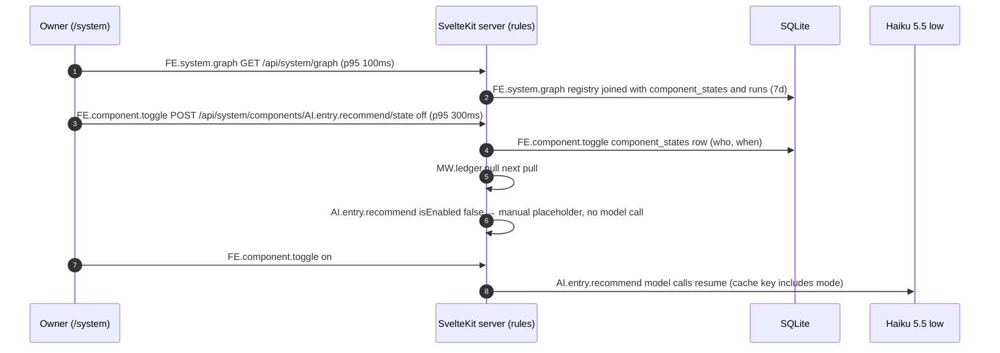

## 4c. Ledger adapters (`/ledgers`)

A ledger connection (`ledger_connections`) is one Slash or Mercury account set, later Plaid/CSV. Each connection gets a `LedgerAdapter` (`src/lib/server/ledgers/`) that normalizes the ledger's records to `LedgerItem` and declares **capabilities**. Pull, research, the write path and mappings branch on capabilities, never on the ledger's kind.

| Capability | Slash | Mercury | Why Mercury differs |
|---|---|---|---|
| review unit | accounting entry | transaction | Mercury has no accounting entries in its public API |
| chart | ledger (Slash `account` values) | `qbo` (QuickBooks accounts as `qbo:<Id>`) | Mercury's GL coding (`glAllocations`) is read-only |
| code | `ledger` (PATCH entry → Slash syncs) | **`qbo_direct`** (MW.qbo.write) | `PATCH /transaction/{id}` sets only category + note (docs.mercury.com, 2026-11-20) |
| mark ready | yes | — | — |
| mappings | `ledger` (Slash PUT mappings) | `local` (`local_mappings`, Tier 0 precode) | Mercury rules exist only in Mercury Books |
| annotate | — | optional note (off by default) | A Mercury write token must be IP-whitelisted |

**QuickBooks-direct guardrail.** QuickBooks is written only for `qbo_direct` connections, only after a human decision and the undo window, only after dedupe, and always with `requestid` = decision id. A connection can't be activated, or approved against, until the owner has confirmed that the ledger's own QuickBooks sync and the QBO bank feed are off or will be matched (recorded with who and when), and has mapped each ledger account to a QuickBooks bank account.

**Dedupe (rule)** looks for QuickBooks transactions on the mapped bank account with the same amount within ±3 days. Other LaceLuxx-written transactions are ignored, so recurring same-amount charges aren't mistaken for duplicates.

| Match | Result |
|---|---|
| Our own transaction for this decision | ready, nothing written |
| Uncategorized | sparse-update its lines |
| Same account | ready, nothing written |
| Different account | entry `invalid` for a human |
| None | create |

### Mercury expense (QuickBooks direct)

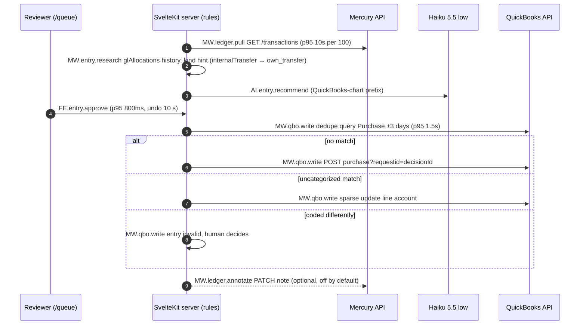

## 4d. Companies, sign-in and roles (M8)

**Tenancy.** Every tenant table has `org_id` (default `current_setting('app.org_id', true)`) and one row-level-security policy, `tenant_isolation USING/WITH CHECK (org_id = current_setting('app.org_id', true))`, generated into `drizzle/0001_rls.sql` by `scripts/gen-rls.ts` (`--check` in CI). Ids that come from outside (Slash/Mercury ids, `qbo:<Id>`, `conn_slash`) use composite keys `(org_id, id)`, so two companies can hold the same external id. Tables without RLS: `orgs`, `users` (global; read by exact key only).

**How a request becomes a company context.** `hooks.server.ts` resolves the caller — Google session (Auth.js), `Authorization: Bearer llx_…`, or the local dev bypass — to an identity, picks the company (`books_org` cookie if a member, else the first membership; tokens are pinned to their company) and runs the request inside `withOrg(company, …, actor)`. `withOrg` reserves a connection, sets `app.org_id`, and `SET ROLE books_app` (non-owner, RLS applies). The app connects as the database owner only so that identity lookups (which company does this email belong to?) work before a company is known; `getDb()` throws outside a company context. Queued jobs re-enter the company that queued them; the scheduler loops per company.

**Roles** come from the command registry (`role` on every entry; `arch:check` fails without one, and no write is open to viewers except switching company). `handle()` returns 403 below the role and writes one `audit_log` row per successful write (actor = user id or `token:<id>`; keys matching token/secret/password/key/credential redacted).

| Role | Can |
|---|---|
| viewer | every read (queue, entries, evals, system, ledgers) |
| reviewer | + pull, recommend, approve, undo, ask, reject, answer, payouts, eval add |
| owner | + switches, ledgers, mapping apply, COA pull, members, tokens |

**Rules that keep it safe:** sign-in admits only a verified Google email with a membership or open invite (Workspace-only consent screen); a company always keeps ≥ 1 owner; removing a member revokes their tokens; tokens are `llx_` + 32 random bytes, stored as sha256, shown once, `last_used_at` written at most once a minute; production refuses to start without Google credentials (no dev bypass).

### Google sign-in (invite accepted)

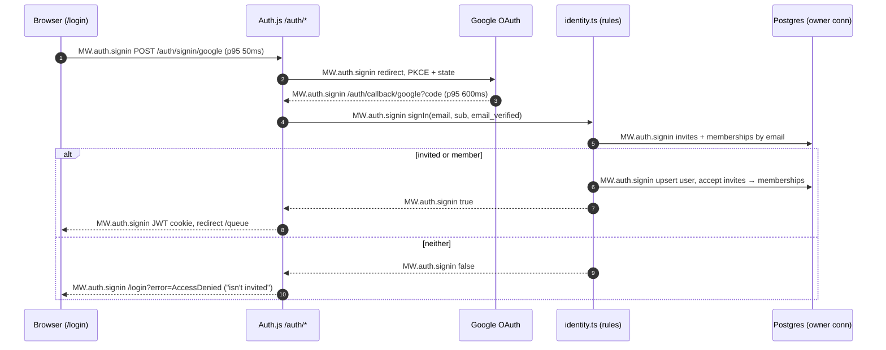

### Request in a company context

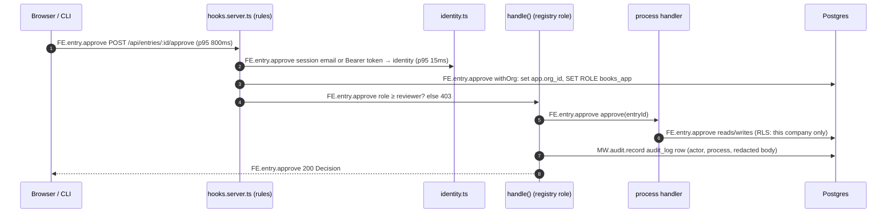

### CLI with a token

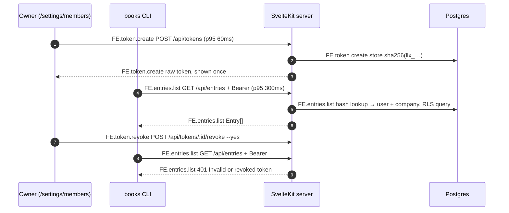

### Invite and token states

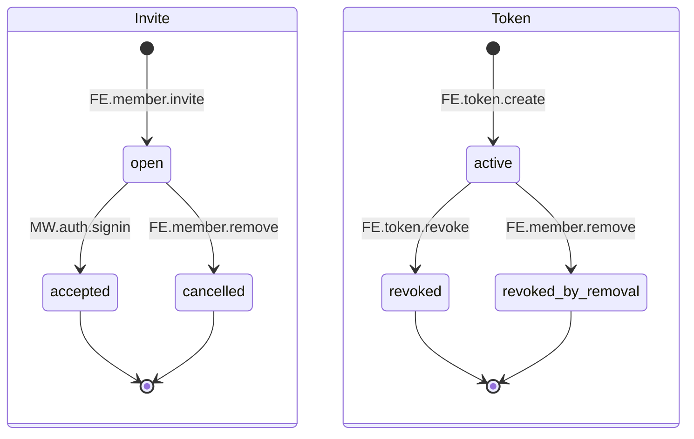

## 5. Operating envelope

Rows 1–2 re-measured 2026-11-21 after the UI redesign (production build, local). Rows 3, 6–8 measured 2026-11-19 (unchanged paths). Text contrast: every text token is ≥ 4.5:1 on every surface in both themes (worst 4.57), button text on the accent ≥ 4.5:1. Rows 4, 5, 9, 10 re-measured 2026-11-21 on Postgres (PGlite, production build, fixture mode, 31 entries in review). Hosted rows H1–H5 are targets until M9 step 6. "est." = estimate with basis.

| # | Layer | Component | Metric | Target | Est. | Actual (2026-11-19) | Measured with |
|---|---|---|---|---|---|---|---|
| 1 | Front-end | `/queue` | LCP / CLS (prod build, local) | ≤ 2.5 s / ≤ 0.1 | 1.2 s | After the redesign (2026-11-21): LCP p50 180 ms, worst 224 ms of 5 · CLS 0.000 · transferred on `/queue`: JS 71 KB, CSS 5 KB, fonts 2 files / 69 KB (self-hosted) | Playwright PerformanceObserver |
| 2 | Front-end | Approve (queue row) | First feedback | ≤ 100 ms | 30 ms | 3 ms to remove the row (optimistic), toast in the same frame (2026-11-21) | Playwright |
| 3 | Front-end | CLI | Startup to first output | ≤ 300 ms | 150 ms | `--help` p50 62 ms · `entries list` (HTTP) p50 111 ms, max 146 ms | 10-run timing (hyperfine not installed) |
| 4 | Back-end | Queue query (incl. company context + RLS) | p95 | ≤ 50 ms | 8 ms | handler p50 7.0 / p95 10.0 ms (PGlite, 2026-11-21) | `server-timing` header, 100 runs |
| 5 | Middleware | `GET /api/entries` | p50 / p95 / p99 | ≤ 300 ms p95 | 40 ms | 13.0 / 19.7 / 23.5 ms (PGlite + identity + RLS, 2026-11-21) | curl loop, 200 runs |
| 6 | Middleware | Approve (2 Slash calls) | p95 | ≤ 800 ms | TBD — Slash latency unknown | fixture only | app `runs.detail_json.e2e_ms` |
| 7 | AI | `AI.entry.recommend` (Haiku 5.5) | e2e | ≤ 4 s (batch, no TTFT target) | ~1.5 s | TBD — live key | `recommendations.ttft_ms / e2e_ms` |
| 8 | AI | Recommend prefix | Cache hit rate | ≥ 70% of input | ~93% (≈1,400 cached / ≈100–300 fresh per call) | fixture-simulated 90%+ | `cache_read_input_tokens` |
| 9 | Infrastructure | App process | Memory headroom at peak | ≥ 20% of 512Mi | ~180 MB RSS (prod path) | production path (postgres-js, no PGlite) 130 MB VmHWM after 100 requests → 75% headroom; with in-process PGlite (local only) 436 MB — PGlite is never loaded on Fly. `--max-old-space-size=384` | /proc VmHWM, 2026-11-21 |
| 10 | Infrastructure | Cold start | Process start → health 200 | ≤ 1 s | ~600 ms | 551 ms production path · 2,987 ms with PGlite WASM init (local dev only); machine stays up, so never on the user path | shell timing, 2026-11-21 |
| H1 | Back-end | Queue query on Neon (direct, in-region, RLS) | p95 | ≤ 50 ms | ~8 ms | TBD — measure in M9 step 6 | `server-timing` |
| H2 | Back-end | First query after Neon idle (scale to zero) | cold | ≤ 1 s | ~300–500 ms (Neon: "a few hundred ms") | TBD — measure in M9 step 6 | timing after 6 min idle |
| H3 | Middleware | `GET /api/entries` hosted | p95 | ≤ 300 ms | ~60 ms | TBD — measure in M9 step 6 | curl loop from iad |
| H4 | Front-end | `/queue` hosted | LCP | ≤ 2.5 s | ~0.8 s | TBD — measure in M9 step 6 | Playwright PerformanceObserver |
| H5 | Infrastructure | Fly machine | peak RSS | ≤ 410 MB (80% of 512Mi) | ~180 MB | TBD — measure in M9 step 6 | `fly machine status`, metrics |

**Neon compute budget (Free: 100 CU-h/month).** No database polling: commits run on per-company timers at each undo deadline, so an idle app sends zero queries and Neon scales to zero after 5 min. Hourly pull wakes it ~5 min × 24 × 30 = 60 h × 0.25 CU = 15 CU-h, plus usage ≈ 10 CU-h → ≈ 25 CU-h (25% of the cap). A 1 s polling tick would have kept 0.25 CU awake 730 h = 182 CU-h — over the cap.

Haiku 5.5's minimum cacheable prefix is 512 tokens (claude-api reference, cached 2026-11-03), so the ~1.4K-token prefix caches. Rate-limit headroom: 300 calls/month is far below any provider limit.

Reliability: every outbound call has a timeout, retry and fallback (interaction directory). Degraded modes are tested: model down (`tests/m2-recommend.test.ts`), QuickBooks down (same), Slash 409/400 (`tests/m3-write.test.ts`).

## 6. Patterns (minimal and repetitive)

| Pattern | Used by | Rule |
|---|---|---|
| Port + fixture (`SlashPort`, `QboPort`, `ModelPort`) | every external call | New integration = a port with a fixture first; live behind a `*_MODE` switch |
| Process handler wrapped in `withRun` | every process | One file per process ID area; every run logged in `runs` |
| Registry entry → route → CLI → palette | every action | Add to `commands.ts`; `arch:check` fails until the route and screen exist |
| `judgment` sandwiched by `rule` | both AI steps | Cache/guard before, Zod + validator after; eval pairs before build |
| Read model in `view.ts` | all GET routes | Rows → shared Zod schemas in `src/lib/types.ts` |
| Company context (`withOrg`) | every tenant read/write: requests (hooks), jobs (`enqueue`), scheduler (`forEachOrg`) | `getDb()` only inside a company context; `getRootDb()` only for orgs/users/identity; RLS enforces it in the database |
| Registry role + audit in `handle()` | every API route | One place checks the role and writes `audit_log`; a new command can't skip either |
| Per-company cache keys | ledger adapters, QuickBooks read cache | Module-level caches key by `currentOrgId()` |
| Timers, not polling | deferred commits | An idle app sends zero queries (Neon scale-to-zero) |

Proof for components added beyond the brief: `FE.entry.undo` (undo needed an endpoint; extending approve with a flag would have hidden a state transition), `FE.coa.list` (entry editing needs the account list; reused `dimension_values`, no new table), `MW.qbo.connect` (named in the brief's `qbo_tokens` writer). M8 additions: `identity.ts` (sign-in and token lookups must run before a company context exists, so they can't live in a process handler that assumes one), `audit.ts` (cross-cutting; called only from `handle()`), `orgs.ts` (`MW.org.create` seeds connections and eval cases inside the new company — no existing process creates a company), `processes/members.ts` (members, invites, tokens share one RLS-scoped module instead of three). No new layout shell: `/settings/members` reuses the card + table shell; the 10 new commands use the existing `<noun> <verb>` grammar.

## 7. Decisions log

| Date | Decision | Why |
|---|---|---|
| 2026-11-19 | Undo = deferred commit (`pending_until`), not a Slash `mark_in_review` | Undoing after mark-ready races Slash's auto-sync (TBD #2) |
| 2026-11-19 | `fetch`-based Slash client, no `slash-sdk` | v2 accounting coverage unverified; ~150 lines |
| 2026-11-19 | Transfers / person payments guarded by a Tier 0 rule before the model | Never code them; saves a call; defense in depth with the validator |
| 2026-11-19 | Fixture model in CI; model quality only in `MODEL_MODE=live` | No keys in CI; harness still proven end to end |
| 2026-11-20 | Ledgers are adapters with capabilities; tables renamed `ledger_items` / `ledger_transactions`; migrations squashed | Mercury is not an accounting entry; nothing deployed yet |
| 2026-11-20 | Mercury = `qbo_direct` (write QuickBooks with dedupe + requestid) | Mercury API can't write GL coding (`PATCH` sets only category/note) |
| 2026-11-20 | Activation needs bank-feed confirmation + bank mapping | Prevents double-booking with Mercury's QuickBooks sync / QBO bank feed |
| 2026-11-20 | `/api/entries` path kept (no `/api/items` rename) | Churn without user value before M8 |
| 2026-11-20 | SQLite → Postgres: Neon in production, PGlite in-process for local dev and tests | Multi-user hosting; tests stay dependency-free and run real Postgres (RLS included) |
| 2026-11-20 | Row-level security per company; app connects as owner and `SET ROLE books_app` per company context | Isolation enforced by the database, not app code; identity lookups need the owner before a company is known |
| 2026-11-20 | Neon **direct** (non-pooled) endpoint | PgBouncer transaction pooling drops the session settings (`app.org_id`, role) RLS relies on |
| 2026-11-20 | No database polling; per-company commit timers + advisory-lock leader | Polling would keep Neon awake (≈ 182 CU-h > 100 free); only one machine runs jobs during a deploy overlap |
| 2026-11-20 | Audit written in `handle()` | Every write path covered in one place; failed writes not audited |
| 2026-11-20 | Google sign-in, invite-only, Workspace accounts; dev bypass refused in production | Owner's choice (2026-11-20/21); no passwords to manage |
| 2026-11-20 | One Fly machine (scheduler in-process), Neon Free | Stays under Fly's $5 waiver: ≈ $3.71/month billed $0 |
