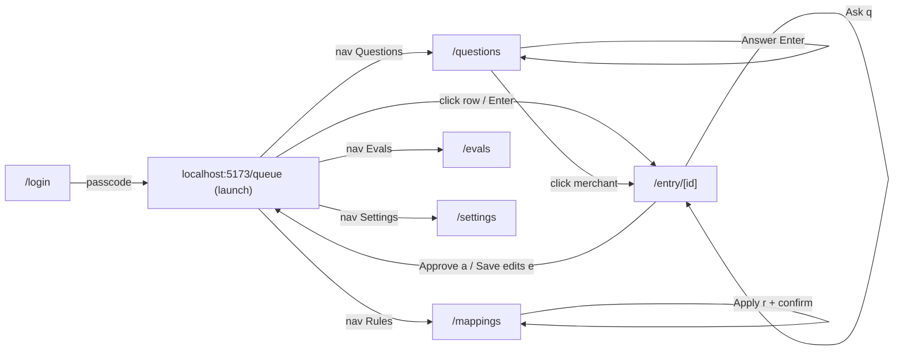
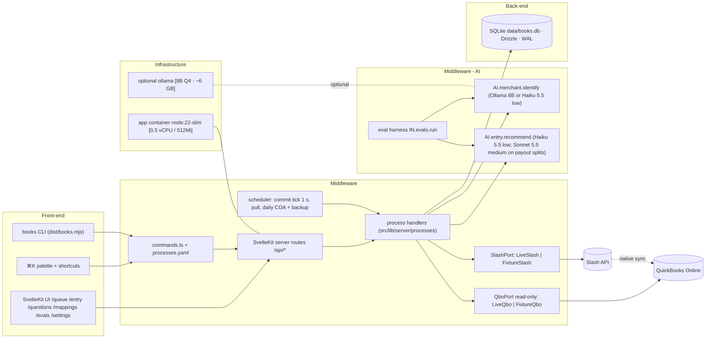
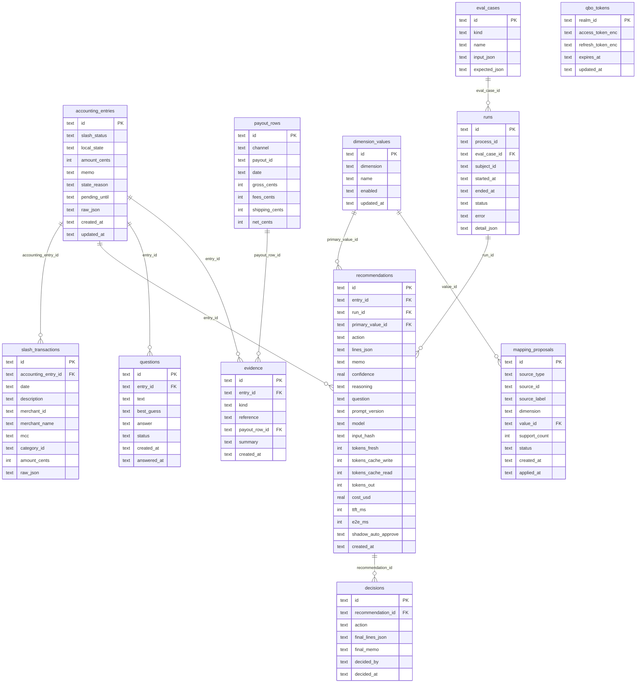
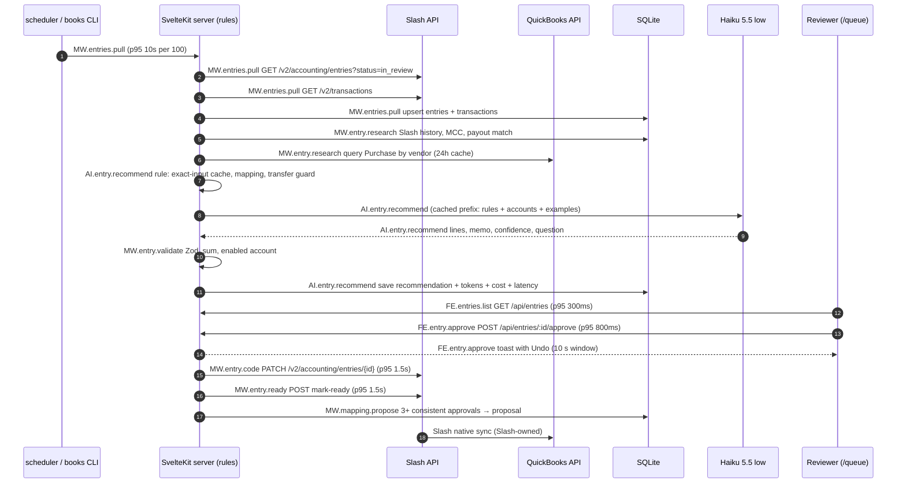
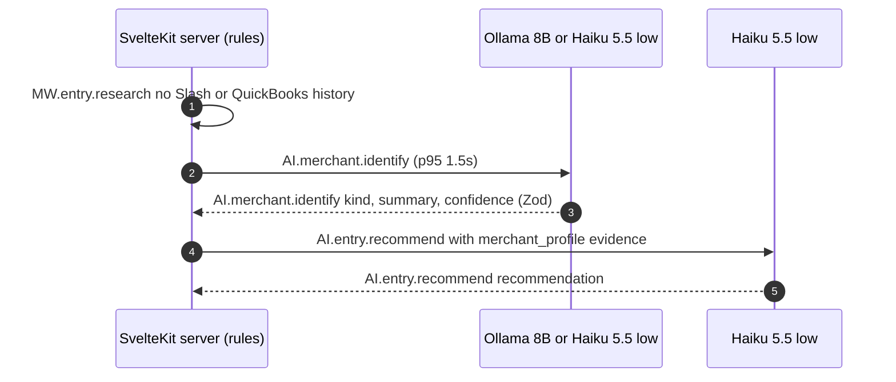
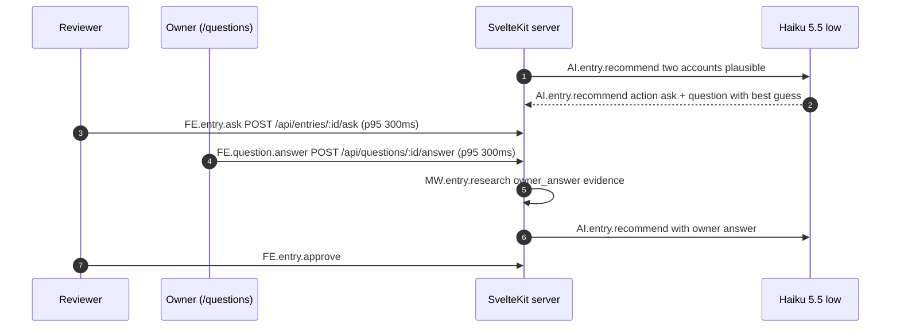
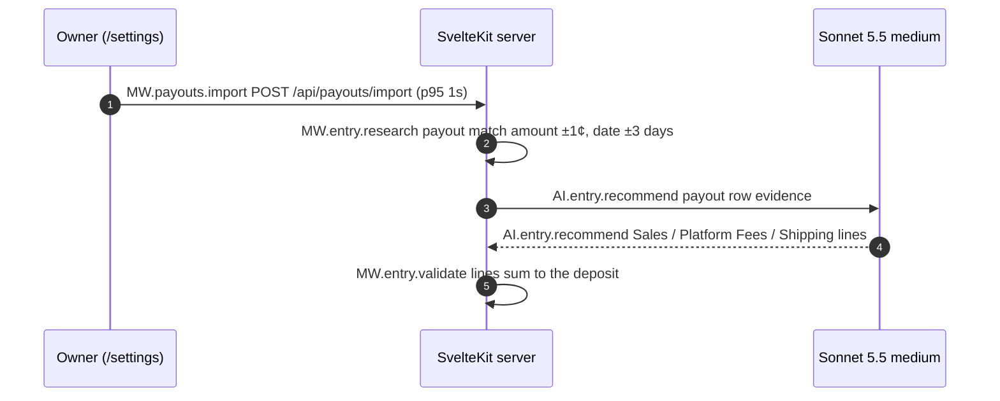
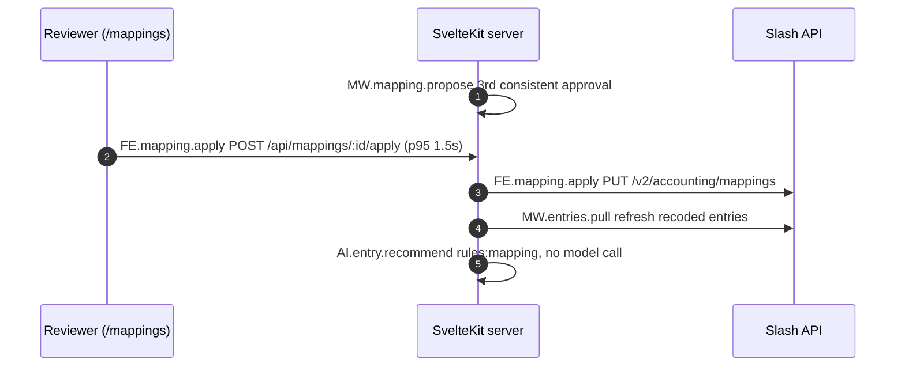
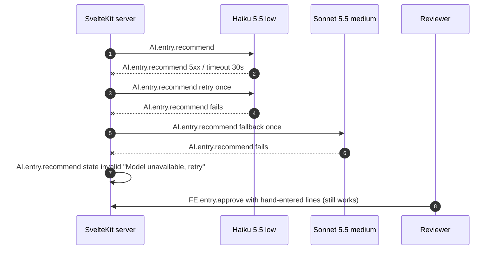
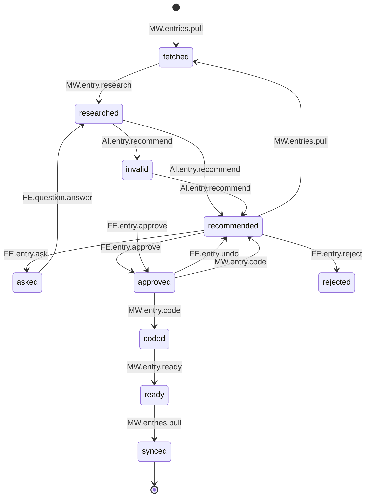

# LaceLuxx Books — Architecture

Codes LaceLuxx's Slash transactions to QuickBooks accounts, explains why, asks the owner when unsure, and learns rules so a question is never asked twice. Written 2026-11-19 from the build brief. Generated blocks (`<!-- gen:* -->`) come from `src/lib/commands.ts`, `processes.yaml` and the Drizzle schema; run `pnpm arch` to refresh and `pnpm arch:check` before a PR.

## 1. Interface contract

### Launch & access

| Item | Value |
|---|---|
| Run locally | `pnpm i && pnpm db:migrate && pnpm db:seed && pnpm dev` |
| Local URL | `http://localhost:5173` → `/queue` |
| Deployed URL | Not deployed in v1 (local only) |
| Auth | `APP_PASSCODE` gate on every route (cookie after `/login`); CLI sends it as `x-books-passcode`. Unset = open local dev, flagged in the nav |
| First screen | `/queue`: entries needing review, newest first, recommendation + confidence + Approve per row |
| CLI | `pnpm books --help` (dev) · `node dist/books.mjs` (built) |

### Route map

| Route | Screen | Reached from | Data (endpoint) | Mockup |
|---|---|---|---|---|
| `/queue` | Review queue (filters: recommended, asked, invalid, sending, ready) | Launch, nav | `GET /api/entries` | canvas `Main`, `States` |
| `/entry/[id]` | Entry detail: evidence, recommendation, edit splits, ask, reject | Queue row | `GET /api/entries/:id`, `GET /api/coa` | canvas `Entry` |
| `/questions` | Open + answered owner questions | Nav, Ask | `GET /api/questions` | follows `Entry` layout shell |
| `/mappings` | Learned rules to apply in Slash | Nav | `GET /api/mappings` | follows `Main` table |
| `/evals` | Eval results, shadow precision, cost by week | Nav | `GET /api/evals` | follows `Main` table |
| `/settings` | Connections, COA pull, payout CSV upload | Nav | `GET /api/settings` | follows `Entry` cards |
| `/login` | Passcode | Any route when signed out | form action | — |

Designed mockups: Claude design canvas "LaceLuxx Books screens" (`Main`, `Entry`, `States` artboards). Every screen has empty, loading (skeleton / progress bar), error (source-tagged: Slash, QuickBooks, Model, with Retry), partial (invalid rows red, rest usable) and success states.

### Actions
<!-- gen:actions -->
| Action | Screen | Shortcut | Calls | Feedback ≤ 100 ms | Confirm / undo |
|---|---|---|---|---|---|
| Pull entries in review from Slash, then research and recommend | `/queue` | `p` | `POST /api/entries/pull` | Spinner on button | — |
| Research and recommend one entry | `/entry/[id]` | `R` | `POST /api/entries/:id/recommend` | Spinner | — |
| Approve: code the entry in Slash and mark it ready to sync | `/queue` | `a` | `POST /api/entries/:id/approve` | Row fades, toast with Undo | Undo for 10 s |
| Undo an approval still inside its undo window | `/queue` | `u` | `POST /api/entries/:id/undo` | Row returns | — |
| Open a question for the owner | `/entry/[id]` | `q` | `POST /api/entries/:id/ask` | Toast | — |
| Reject the recommendation; the entry is coded by hand in Slash | `/entry/[id]` | `x` | `POST /api/entries/:id/reject` | Toast | Requires --yes |
| Answer a question; the entry is re-recommended with the answer | `/questions` | `Enter` | `POST /api/questions/:id/answer` | Row moves to answered | — |
| Write a learned rule to Slash (recodes entries still in review) | `/mappings` | `r` | `POST /api/mappings/:id/apply` | Spinner | Confirm dialog |
| Pull the chart of accounts (Slash account dimension) | `/settings` | — | `POST /api/coa/pull` | Spinner | — |
| Import a Whatnot payout CSV | `/settings` | — | `POST /api/payouts/import` | Spinner | — |
| Run the eval cases (exit 1 if any fail) | `/evals` | `v` | `POST /api/evals/run` | Progress bar | — |
| Turn a decided entry into a golden eval case | `/entry/[id]` | — | `POST /api/evals/cases` | Toast | — |
| Command palette | everywhere | `⌘K` | any registry command | opens instantly | — |
<!-- /gen:actions -->

Queue keyboard: `j`/`k` move, `a` approve, `Enter` open, `p` pull, `u` undo. Entry: `a` approve, `e` save edits & approve, `q` ask, `x` reject, `Esc` back.

### CLI (`books <noun> <verb> [args] [flags]`)
<!-- gen:cli -->
| Command | Args / flags | Does | Exit codes | Calls | Process |
|---|---|---|---|---|---|
| `books entries pull` | `--since` `--dry-run` `--json` | Pull entries in review from Slash, then research and recommend | 0 · 1 · 2 | `POST /api/entries/pull` | `MW.entries.pull` |
| `books entries list` | `--state` `--json` | List local entries | 0 · 1 · 2 | `GET /api/entries` | `FE.entries.list` |
| `books entry show` | `<id>` `--json` | Show one entry with evidence and decisions | 0 · 1 · 2 | `GET /api/entries/:id` | `FE.entries.list` |
| `books entry recommend` | `<id>` `--force` `--json` | Research and recommend one entry | 0 · 1 · 2 | `POST /api/entries/:id/recommend` | `AI.entry.recommend` |
| `books entry approve` | `<id>` `--yes` `--dry-run` `--override` `--lines` `--memo` `--later` `--json` | Approve: code the entry in Slash and mark it ready to sync | 0 · 1 · 2 | `POST /api/entries/:id/approve` | `FE.entry.approve` |
| `books entry undo` | `<id>` `--json` | Undo an approval still inside its undo window | 0 · 1 · 2 | `POST /api/entries/:id/undo` | `FE.entry.undo` |
| `books entry ask` | `<id>` `--text` `--json` | Open a question for the owner | 0 · 1 · 2 | `POST /api/entries/:id/ask` | `FE.entry.ask` |
| `books entry reject` | `<id>` `--yes` `--reason` `--json` | Reject the recommendation; the entry is coded by hand in Slash | 0 · 1 · 2 | `POST /api/entries/:id/reject` | `FE.entry.reject` |
| `books questions list` | `--status` `--json` | List questions for the owner | 0 · 1 · 2 | `GET /api/questions` | `FE.questions.list` |
| `books question answer` | `<id>` `--text` `--json` | Answer a question; the entry is re-recommended with the answer | 0 · 1 · 2 | `POST /api/questions/:id/answer` | `FE.question.answer` |
| `books mappings list` | `--status` `--json` | List learned rules | 0 · 1 · 2 | `GET /api/mappings` | `FE.mappings.list` |
| `books mapping apply` | `<id>` `--yes` `--dry-run` `--json` | Write a learned rule to Slash (recodes entries still in review) | 0 · 1 · 2 | `POST /api/mappings/:id/apply` | `FE.mapping.apply` |
| `books coa pull` | `--dry-run` `--json` | Pull the chart of accounts (Slash account dimension) | 0 · 1 · 2 | `POST /api/coa/pull` | `MW.coa.pull` |
| `books coa list` | `--json` | List accounts from the local chart of accounts | 0 · 1 · 2 | `GET /api/coa` | `FE.coa.list` |
| `books payouts import` | `<file>` `--channel` `--json` | Import a Whatnot payout CSV | 0 · 1 · 2 | `POST /api/payouts/import` | `MW.payouts.import` |
| `books evals run` | `--json` | Run the eval cases (exit 1 if any fail) | 0 · 1 · 2 | `POST /api/evals/run` | `IN.evals.run` |
| `books evals show` | `--json` | Show the last eval run, shadow precision and cost by week | 0 · 1 · 2 | `GET /api/evals` | `FE.evals.show` |
| `books eval add` | `<entry>` `--json` | Turn a decided entry into a golden eval case | 0 · 1 · 2 | `POST /api/evals/cases` | `FE.eval.add` |
| `books settings show` | `--json` | Show connections and configuration | 0 · 1 · 2 | `GET /api/settings` | `FE.settings.show` |
<!-- /gen:cli -->

Rules: data → stdout, logs → stderr; `--json` returns the API schema; exit 0 ok · 1 user error (HTTP 4xx) · 2 upstream/system error (HTTP 5xx, server unreachable). Every Slash write needs `--yes` and supports `--dry-run`. `--help` is generated from the registry.

```
$ books entries pull --since 2026-11-01
Pulled 23 entries in review (Slash) · 4 new merchants · 23 recommended
$ books entry approve ae_0051
error: books entry approve writes to Slash; pass --yes to confirm or --dry-run to preview      (exit 1)
$ books entry approve ae_0051 --yes
error: The recommendation is a question, not a coding; answer it or pass --lines              (exit 1)
$ books entry approve ae_0050 --yes
Coded ae_0050 → Shipping & Postage · marked ready to sync
```

### Screen flow



## 2. Systems architecture



Products and what they use:

| Product / feature | Components | Tables owned | Models / agents |
|---|---|---|---|
| Review queue | UI `/queue`, `MW.entries.pull`, `MW.entry.research`, `FE.entry.approve`, `MW.entry.code`, `MW.entry.ready` | `accounting_entries`, `slash_transactions`, `evidence`, `decisions` | `AI.entry.recommend` (Haiku 5.5 low) |
| Unknown merchants | `MW.entry.research` | `evidence` | `AI.merchant.identify` (Ollama or Haiku 5.5 low) |
| Owner questions | UI `/questions`, `FE.entry.ask`, `FE.question.answer` | `questions` | re-runs `AI.entry.recommend` |
| Payout splits | `MW.payouts.import` | `payout_rows` | `AI.entry.recommend` (Sonnet 5.5 medium) |
| Learned rules | `MW.mapping.propose`, `FE.mapping.apply` | `mapping_proposals` | none (Tier 0; replaces model calls) |
| Evals & precision | `IN.evals.run`, `/evals` | `eval_cases`, `runs` | both AI steps |
| QuickBooks connect | `MW.qbo.connect` | `qbo_tokens` | none |

**Key decision — Slash is the only write path.** Slash creates an accounting entry per settled transaction and syncs it to QuickBooks. The app codes and approves entries in Slash; it reads QuickBooks only. No QuickBooks writes in v1.

### Backend ERD
<!-- gen:erd -->

<!-- /gen:erd -->

## 3. Sequence diagrams

### Routine expense (with undo window)



### Unknown merchant



### Owner question



### Whatnot payout



### Learn a rule



### Degraded: model down



### Accounting entry state



## 4. State and process directory

State cards (table → writers):
<!-- gen:states -->
| Component (table) | Written by |
|---|---|
| `accounting_entries` | `MW.entries.pull`, `MW.entry.research`, `AI.entry.recommend`, `FE.entry.approve`, `FE.entry.undo`, `MW.entry.code`, `MW.entry.ready`, `FE.entry.ask`, `FE.entry.reject`, `FE.question.answer` |
| `decisions` | `FE.entry.approve`, `FE.entry.undo`, `FE.entry.ask`, `FE.entry.reject` |
| `dimension_values` | `MW.coa.pull` |
| `eval_cases` | `FE.eval.add` |
| `evidence` | `MW.entry.research`, `AI.merchant.identify`, `FE.question.answer` |
| `mapping_proposals` | `MW.mapping.propose`, `FE.mapping.apply` |
| `payout_rows` | `MW.payouts.import` |
| `qbo_tokens` | `MW.qbo.connect` |
| `questions` | `FE.entry.ask`, `FE.question.answer` |
| `recommendations` | `AI.entry.recommend` |
| `runs` | `IN.evals.run` |
| `slash_transactions` | `MW.entries.pull` |
<!-- /gen:states -->

`accounting_entries` invariants: lines sum to the transaction amount; local state never goes ahead of Slash status; nothing is written to Slash without a recorded human decision; an approved entry is written only after `pending_until`.

Other multi-state components: `questions` (open → answered, `FE.question.answer`), `mapping_proposals` (proposed → applied by `FE.mapping.apply`, or → dismissed by `MW.mapping.propose` on conflict).

### Process cards
<!-- gen:processes -->
| ID | Trigger | Input | Processing | Output | Fails as | Accept | Budget (p95 · $/run) |
|---|---|---|---|---|---|---|---|
| `MW.coa.pull` | Daily scheduler, `books coa pull`, first pull | Slash account dimension values (SlashDimensionValue[]) | **rule**: upsert account values with enabled flag | dimension_values rows → CoaPull | 2: Slash error (key missing, no account dimension, 5xx after retries) | tests/m1-pull.test.ts — 11 accounts, disabled flag kept | 2000 ms · $0 |
| `MW.entries.pull` | Hourly (PULL_INTERVAL_MIN), `books entries pull`, Pull button | { since?: date, dryRun?: bool } + Slash entries (in_review, ready_to_sync, synced) + transactions | **rule**: list entries by status, fetch their transactions<br>**rule**: upsert; changed raw (e.g. mapping recode) → back to fetched; ready→synced<br>**rule**: queue research → recommend for new/changed entries | PullResult; accounting_entries fetched, slash_transactions | 2: Slash 429/5xx after 5 tries with jitter; run marked failed | tests/m1-pull.test.ts — 23 in → 23 rows, rerun idempotent | 10000 ms · $0 |
| `MW.entry.research` | After pull, after an owner answer, payout import | accounting entry + transaction; payout_rows; QuickBooks vendors/purchases | **rule**: Slash history by merchant id (or normalized description)<br>**rule**: QuickBooks purchases by vendor name, trigram ≥ 0.6<br>**rule**: MCC table lookup<br>**rule**: payout match: amount ± $0.01, date ± 3 days<br>**rule**: no history + card merchant → AI.merchant.identify | evidence rows; state researched | Partial: missing source noted in state_reason; continues | tests/m2-recommend.test.ts — USPS evidence kinds, QuickBooks-down partial | 1500 ms · $0 |
| `AI.merchant.identify` | Research found no Slash or QuickBooks history | { merchantName, mcc, description } | **rule**: build prompt identify.v1<br>**judgment** (Ollama 8B if OLLAMA_URL else Haiku 5.5 low): classify merchant kind<br>**rule**: Zod; failure → unknown | evidence(kind=merchant_profile) | Schema fail or model down → kind unknown, confidence 0 | Fixture identify table; live: ≥ 8/10 merchant fixtures (TBD — add 10 cases) | 1500 ms · $0.0003 |
| `AI.entry.recommend` | After research; `books entry recommend`; Recommend again | RecInput { transaction{description, amountCents, mcc, kind}, evidence[], ownerAnswers[] } + enabled accounts | **rule**: exact-input cache: unchanged hash → reuse stored output<br>**rule**: Slash mapping precoded → code it (rules:mapping)<br>**rule**: own transfer / person payment without owner answer → ask (rules:guard)<br>**judgment** (Haiku 5.5 low; Sonnet 5.5 medium when a payout row matched): account, lines, memo, confidence, question<br>**rule**: Zod; 1 retry; fallback to Sonnet once; then invalid<br>**rule**: MW.entry.validate | recommendations row (tokens, cost, ttft, e2e); state recommended \| invalid | Model down after retry + fallback → invalid 'Model unavailable, retry' | 6/6 seed eval cases; ≥ 95% shadow precision on first 100 decisions | 4000 ms · $0.0005 |
| `MW.entry.validate` | After every recommendation and every approval | RecOutput + { amountCents, enabled accounts, tx kind, hasOwnerAnswer } | **rule**: sum = amount, accounts enabled, integer cents, ask has question, never code transfers | error list (empty = valid) | — | tests/rules.test.ts | 5 ms · $0 |
| `FE.entry.approve` | Button a / Save edits e, `books entry approve <id> --yes` | entry id, optional edited lines + memo, override, later | **rule**: no open question (unless override); state recommended/invalid; validate lines<br>**human**: decision recorded with who and when (approved \| edited)<br>**rule**: later: hold for the undo window (pending_until); else commit now | Decision; state approved | 1: open question, bad state, invalid lines | tests/m3-write.test.ts, tests/e2e/queue.spec.ts | 800 ms · $0 |
| `FE.entry.undo` | Undo in toast (u), `books entry undo <id>` | entry id inside its undo window | **human**: undone decision recorded; state back to recommended | Decision; state recommended | 1: window closed (already sending) | tests/m3-write.test.ts — no Slash write after undo | 300 ms · $0 |
| `MW.entry.code` | Commit tick after the undo window, or approve without --later | latest decision lines | **rule**: PATCH /v2/accounting/entries/{id} (dimensions or lineItems), idempotency key = decision:code | state coded | 409 sync in progress → retry in 60 s; 400 → recommended with error | tests/m3-write.test.ts | 1500 ms · $0 |
| `MW.entry.ready` | After MW.entry.code | entry id | **rule**: POST mark-ready, idempotency key = decision:ready | state ready (Slash ready_to_sync) | Error surfaced on the row; stays coded | tests/m3-write.test.ts | 1500 ms · $0 |
| `FE.entry.ask` | Ask (q), `books entry ask <id>` | entry id, optional question text (defaults to the recommendation's) | **human**: question recorded; decision asked | Question; state asked | 1: already asked, bad state | tests/m3-write.test.ts | 300 ms · $0 |
| `FE.entry.reject` | Reject (x) + confirm, `books entry reject <id> --yes` | entry id, optional reason | **human**: rejected decision recorded; coded by hand in Slash | Decision; state rejected | 1: no --yes, bad state | tests/m3-write.test.ts | 300 ms · $0 |
| `FE.question.answer` | Questions screen Enter, `books question answer <id> --text` | question id, answer text | **human**: answer recorded as evidence(owner_answer)<br>**rule**: queue research → recommend | Question answered; state researched | 1: empty answer, already answered | tests/m3-write.test.ts | 300 ms · $0 |
| `MW.mapping.propose` | After every approve or undo | latest decision per entry for the merchant | **rule**: ≥ 3 approvals to the same single account, 0 conflicts → proposal; conflict → dismiss | mapping_proposals row | — | tests/m4-learn.test.ts | 50 ms · $0 |
| `FE.mapping.apply` | Rules screen Apply + confirm, `books mapping apply <id> --yes` | proposal id | **human**: confirm<br>**rule**: PUT /v2/accounting/mappings (applyToExistingEntries), then pull to refresh recoded entries | proposal applied | 1: no --yes; 2: Slash error | tests/m4-learn.test.ts — next USPS entry coded by rules:mapping, no model call | 1500 ms · $0 |
| `MW.payouts.import` | Settings upload, `books payouts import <csv>` | CSV payout_id,date,gross,fees,shipping,net | **rule**: parse + validate (gross − fees − shipping = net ± 1¢)<br>**rule**: upsert; re-research credits waiting for review | payout_rows | 1: bad CSV with line numbers | tests/rules.test.ts, tests/m2-recommend.test.ts | 1000 ms · $0 |
| `IN.evals.run` | `books evals run`, Evals screen (v), CI | eval_cases | **rule**: replay AI.merchant.identify + AI.entry.recommend per case, score against expected | EvalRun; runs rows per case | 1: any case fails | 6/6 seed | 30000 ms · $0.005 |
| `FE.eval.add` | Entry screen 'Add as eval case', `books eval add <entry>` | entry with an approved decision | **human**: freeze current input + human lines as a golden case | eval_cases row | 1: no approved decision | manual | 100 ms · $0 |
| `MW.qbo.connect` | Settings → Connect QuickBooks | Intuit OAuth 2.0 code + realmId | **rule**: exchange code, store encrypted tokens (rotating refresh) | qbo_tokens row | 400 state mismatch; 502 token exchange | TBD — sandbox test once QBO keys exist | 2000 ms · $0 |
| `FE.entries.list` | Queue / entry screens, `books entries list`, `books entry show` | state filter | **rule**: read model | Entry[] / EntryDetail | — | e2e | 300 ms · $0 |
| `FE.questions.list` | Questions screen, `books questions list` | status | **rule**: read model | Question[] | — | e2e | 300 ms · $0 |
| `FE.mappings.list` | Rules screen, `books mappings list` | status | **rule**: read model | MappingProposal[] | — | e2e | 300 ms · $0 |
| `FE.evals.show` | Evals screen, `books evals show` | — | **rule**: last run, shadow precision, cost by week | EvalSummary | — | manual | 300 ms · $0 |
| `FE.settings.show` | Settings screen, `books settings show` | — | **rule**: read config | Settings | — | manual | 100 ms · $0 |
| `FE.coa.list` | Entry screen account picker, `books coa list` | — | **rule**: read dimension_values | Account[] | — | e2e | 100 ms · $0 |
<!-- /gen:processes -->

### Interaction directory
<!-- gen:interactions -->
| From | To | Via | Sync | Payload | Timeout / retry / fallback |
|---|---|---|---|---|---|
| `MW.entries.pull` | Slash API | HTTPS | sync | GET /v2/accounting/entries, /v2/transactions | 10 s; 5 tries, jittered backoff; run failed |
| `MW.coa.pull` | Slash API | HTTPS | sync | GET /v2/accounting/dimensions(+values) | 10 s; 5 tries |
| `MW.entry.research` | QuickBooks API | HTTPS | sync | query Vendor, Purchase (24 h cache) | 10 s; 2 tries; continue without QuickBooks evidence |
| `AI.merchant.identify` | Ollama | Anthropic | HTTP | sync | identify.v1 | 20 s; Ollama → Haiku |
| `AI.entry.recommend` | Anthropic | HTTPS | sync | recommend.v1 (cached prefix) | 30 s; 1 retry; Sonnet once; else invalid |
| `MW.entry.code` | Slash API | HTTPS | sync | PATCH entry | 10 s; idempotency key = decision id |
| `MW.entry.ready` | Slash API | HTTPS | sync | POST mark-ready | 10 s; idempotency key = decision id |
| `FE.mapping.apply` | Slash API | HTTPS | sync | PUT /v2/accounting/mappings | 10 s; idempotency key = proposal id |
| `MW.qbo.connect` | Intuit OAuth | HTTPS | sync | token exchange | 10 s; no retry |
<!-- /gen:interactions -->

### Use-case traces
<!-- gen:traces -->
| Use case | Actor | Trigger | Processes | End state |
|---|---|---|---|---|
| Routine expense | Cron, reviewer | Hourly pull | `MW.coa.pull` → `MW.entries.pull` → `FE.entries.list` → `MW.entry.research` → `AI.entry.recommend` → `MW.entry.validate` → `FE.entry.approve` → `MW.entry.code` → `MW.entry.ready` → `MW.mapping.propose` | ready |
| Unknown merchant | Cron, reviewer | Hourly pull | `MW.entries.pull` → `MW.entry.research` → `AI.merchant.identify` → `AI.entry.recommend` → `MW.entry.validate` → `FE.entry.approve` → `MW.entry.code` → `MW.entry.ready` | ready |
| Owner question | Reviewer, owner | Low confidence | `AI.entry.recommend` → `FE.entry.ask` → `FE.questions.list` → `FE.question.answer` → `MW.entry.research` → `AI.entry.recommend` → `FE.entry.approve` → `MW.entry.code` → `MW.entry.ready` | ready |
| Undo | Reviewer | Approve then Undo within 10 s | `FE.entry.approve` → `FE.entry.undo` → `MW.mapping.propose` | recommended |
| Reject | Reviewer | Wrong recommendation | `FE.entry.reject` | rejected |
| Whatnot payout | Owner, reviewer | Payout lands | `MW.payouts.import` → `MW.entry.research` → `AI.entry.recommend` → `MW.entry.validate` → `FE.entry.approve` → `MW.entry.code` → `MW.entry.ready` | ready |
| Learn a rule | Reviewer | 3rd consistent approval | `MW.mapping.propose` → `FE.mappings.list` → `FE.mapping.apply` → `MW.entries.pull` → `AI.entry.recommend` | mapping in Slash; next entry coded by rules:mapping |
| Degraded: model down | Cron | Anthropic 5xx | `AI.entry.recommend` | invalid — 'Model unavailable, retry'; manual edit-and-approve still works |
| Evals | Reviewer, CI | `books evals run` | `IN.evals.run` → `AI.merchant.identify` → `AI.entry.recommend` → `FE.evals.show` → `FE.eval.add` | EvalRun |
| Setup | Owner | First run | `FE.settings.show` → `MW.qbo.connect` → `MW.coa.pull` → `FE.coa.list` | connected |
<!-- /gen:traces -->

## 5. Operating envelope

Measured 2026-11-19 in this container (fixture mode, 72 entries). "est." = estimate with basis.

| # | Layer | Component | Metric | Target | Est. | Actual (2026-11-19) | Measured with |
|---|---|---|---|---|---|---|---|
| 1 | Front-end | `/queue` | LCP / CLS (prod build, local) | ≤ 2.5 s / ≤ 0.1 | 1.2 s | LCP p50 240 ms, worst 520 ms of 5 · CLS 0.000 · JS 79 KB gzip total | Playwright PerformanceObserver |
| 2 | Front-end | Approve (queue row) | First feedback | ≤ 100 ms | 30 ms | 38 ms (row hide + toast) | Playwright |
| 3 | Front-end | CLI | Startup to first output | ≤ 300 ms | 150 ms | `--help` p50 62 ms · `entries list` (HTTP) p50 111 ms, max 146 ms | 10-run timing (hyperfine not installed) |
| 4 | Back-end | Queue query | p95 | ≤ 50 ms | 5 ms | 2 ms (handler incl. SQLite, 72 entries) | `server-timing` header, 100 runs |
| 5 | Middleware | `GET /api/entries` | p50 / p95 / p99 | ≤ 300 ms p95 | 40 ms | 2.1 / 3.8 / 5.0 ms · `/queue` SSR p95 8.6 ms | curl loop, 200 runs |
| 6 | Middleware | Approve (2 Slash calls) | p95 | ≤ 800 ms | TBD — Slash latency unknown | fixture only | app `runs.detail_json.e2e_ms` |
| 7 | AI | `AI.entry.recommend` (Haiku 5.5) | e2e | ≤ 4 s (batch, no TTFT target) | ~1.5 s | TBD — live key | `recommendations.ttft_ms / e2e_ms` |
| 8 | AI | Recommend prefix | Cache hit rate | ≥ 70% of input | ~93% (≈1,400 cached / ≈100–300 fresh per call) | fixture-simulated 90%+ | `cache_read_input_tokens` |
| 9 | Infrastructure | App process | Memory headroom at peak | ≥ 20% of 512Mi | ~150 MB RSS | peak RSS 157 MB → 69% headroom; limit could drop to 256Mi (157 × 1.3 = 204 MB) — re-check in Docker | /proc VmHWM after 330 requests (Docker not in this container) |
| 10 | Infrastructure | Cold start | Process start → health 200 | ≤ 1 s | ~600 ms | 513 ms | shell timing |

Haiku 5.5's minimum cacheable prefix is 512 tokens (claude-api reference, cached 2026-11-03), so the ~1.4K-token prefix caches. Rate-limit headroom: 300 calls/month is far below any provider limit.

Reliability: every outbound call has a timeout, retry and fallback (interaction directory). Degraded modes are tested: model down (`tests/m2-recommend.test.ts`), QuickBooks down (same), Slash 409/400 (`tests/m3-write.test.ts`).

## 6. Patterns (minimal and repetitive)

| Pattern | Used by | Rule |
|---|---|---|
| Port + fixture (`SlashPort`, `QboPort`, `ModelPort`) | every external call | New integration = a port with a fixture first; live behind a `*_MODE` switch |
| Process handler wrapped in `withRun` | every process | One file per process ID area; every run logged in `runs` |
| Registry entry → route → CLI → palette | every action | Add to `commands.ts`; `arch:check` fails until the route and screen exist |
| `judgment` sandwiched by `rule` | both AI steps | Cache/guard before, Zod + validator after; eval pairs before build |
| Read model in `view.ts` | all GET routes | Rows → shared Zod schemas in `src/lib/types.ts` |

Proof for components added beyond the brief: `FE.entry.undo` (undo needed an endpoint; extending approve with a flag would have hidden a state transition), `FE.coa.list` (entry editing needs the account list; reused `dimension_values`, no new table), `MW.qbo.connect` (named in the brief's `qbo_tokens` writer).

## 7. Decisions log

| Date | Decision | Why |
|---|---|---|
| 2026-11-19 | Undo = deferred commit (`pending_until`), not a Slash `mark_in_review` | Undoing after mark-ready races Slash's auto-sync (TBD #2) |
| 2026-11-19 | `fetch`-based Slash client, no `slash-sdk` | v2 accounting coverage unverified; ~150 lines |
| 2026-11-19 | Transfers / person payments guarded by a Tier 0 rule before the model | Never code them; saves a call; defense in depth with the validator |
| 2026-11-19 | Fixture model in CI; model quality only in `MODEL_MODE=live` | No keys in CI; harness still proven end to end |
