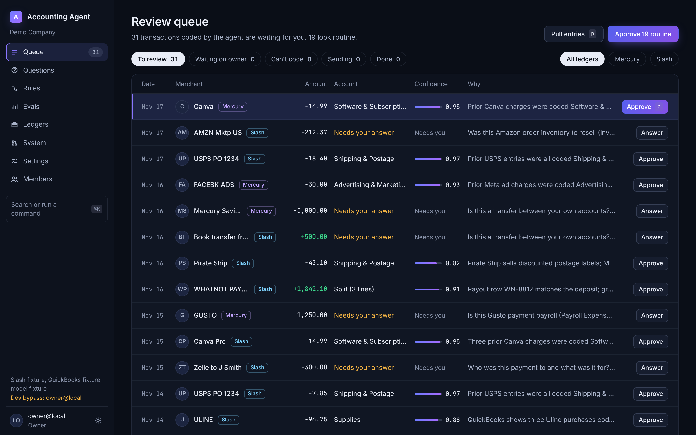
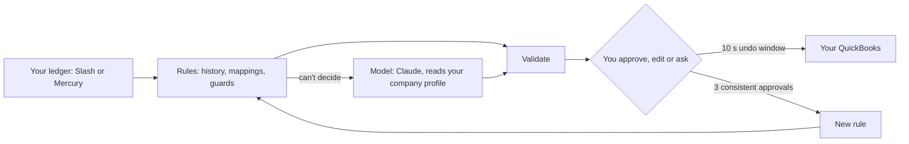
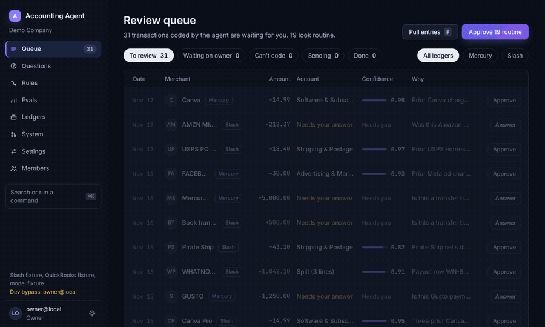
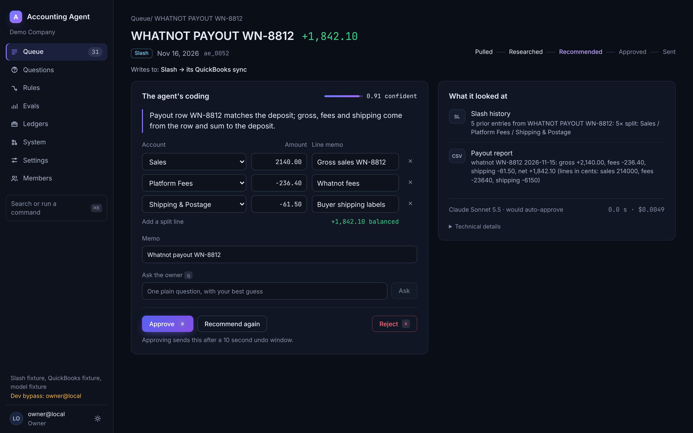

# Accounting Agent

An AI bookkeeper for small businesses. It codes your bank and card transactions to the right QuickBooks accounts, shows its reasoning, asks you when it isn't sure, and learns your rules. You approve every entry before anything reaches your books.



## Get started (5 steps, about 10 minutes)

| # | Do this | Where | You need |
|---|---|---|---|
| 1 | **Sign in** with any Google account | the app's login page | a Google account |
| 2 | **Create your company**: its name and one sentence on what it does | `/welcome` (opens automatically) | — |
| 3 | **Connect your bank or card ledger**: Ledgers → Add connection → paste the key | `/ledgers` | a **Slash API key** or a **Mercury API token** (see below) |
| 4 | **Connect QuickBooks**: Settings → Connect QuickBooks, sign in with your Intuit login | `/settings` | your QuickBooks Online login (no key) |
| 5 | **Pull and approve**: Pull chart of accounts, then Queue → Pull, then approve your first entry | `/settings`, `/queue` | — |

A checklist on the Settings page tracks these steps.

### The keys you paste

| Ledger | Key | Where to get it | Permissions |
|---|---|---|---|
| Slash | API key (+ legal entity id if you have several entities) | [Slash dashboard → Settings → Developer](https://app.slash.com/settings/developer) | Read transactions and accounting fields |
| Mercury | API token | [Mercury → Settings → Tokens](https://app.mercury.com/settings/tokens) | Read-only is enough |

- **The key is checked before it's saved.** The app tests it with Slash or Mercury first. A rejected key is never stored, and the error tells you where to find the right one.
- **Each key belongs to one company.** It's encrypted at rest, scoped to your company, and never shown again. Paste a new one to replace it.
- **QuickBooks never needs a key.** You sign in with Intuit and approve access, and the app never sees your password.
- **Nothing moves money.** The app has no endpoints for payments, transfers or cards.

**Just looking?** In step 3, choose **Sample data** to explore with synthetic transactions first.

## What it does

- **Codes transactions.** It pulls from Slash or Mercury and picks the QuickBooks account for each transaction. Marketplace payouts are split into sales, fees and shipping.
- **Shows its work.** Every recommendation comes with a confidence level, a one-line reason and the evidence it used.
- **Asks instead of guessing.** Ambiguous purchases, transfers between your own accounts and payments to people go to the owner as a plain question.
- **Follows your rules.** In Settings → Company you describe the business and list house rules ("Shipping labels → Shipping & Postage"). After three consistent approvals it proposes a new rule for that merchant.

## How it works



Cheap, deterministic rules run first. The model is called only when the rules can't decide, and code checks its answer before you see it.

| Approve, with undo | The agent asks when unsure | See and switch every agent |
|---|---|---|
|  |  |  |

| Entry: reasoning and evidence | Evals and cost | Team and roles |
|---|---|---|
|  |  |  |

## Try it on your machine (demo data, no keys)

```bash
pnpm i && pnpm db:reset && pnpm db:seed && pnpm dev
```

Open http://localhost:5173. You're signed in as the owner of a demo company with synthetic Slash, Mercury and QuickBooks data.

## Why it's built this way

- **A human decides.** Nothing reaches the books without a recorded approval, and every write is audited.
- **Many companies, isolated.** Each company's data is separated in the database itself (Postgres row-level security), with owner, reviewer and viewer roles. Invite your bookkeeper under Settings → Members.
- **Tested like software.** The model steps have eval cases (must-pass, edge and must-refuse) that run in CI.
- **Costs cents.** Rules and caching handle routine transactions, and a typical recommendation costs a fraction of a cent.

## Under the hood

SvelteKit and TypeScript, Postgres (Neon) with Drizzle, and Claude through the Anthropic API, hosted on Fly.io. One command registry drives the web UI, the `books` CLI and the ⌘K palette.

**Why TypeScript?** Svelte (the UI framework) is written in TypeScript, so the browser, the API, the CLI and the database layer share one language and one set of types. The compiler catches a renamed field before it ships.

- [docs/self-host.md](docs/self-host.md): run your own server (Google sign-in, Intuit app, Anthropic key, Fly + Neon) and all commands
- [ARCHITECTURE.md](ARCHITECTURE.md): system design, data model, sequence diagrams, performance numbers
- [docs/design/brief.md](docs/design/brief.md): design principles and tokens

Hosted instance: https://svelte-accounting-agent.fly.dev
