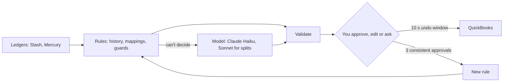
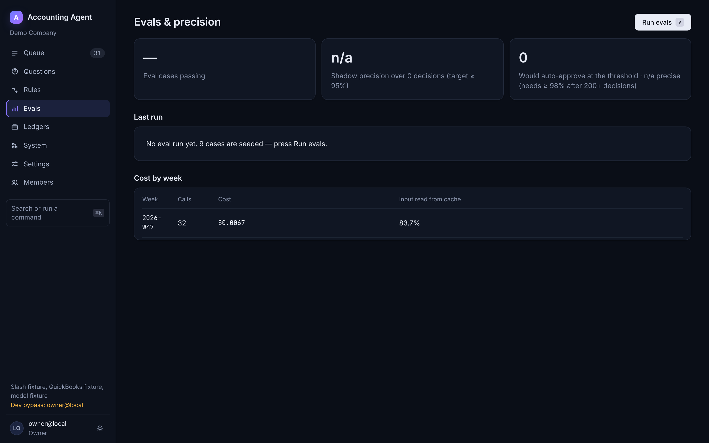
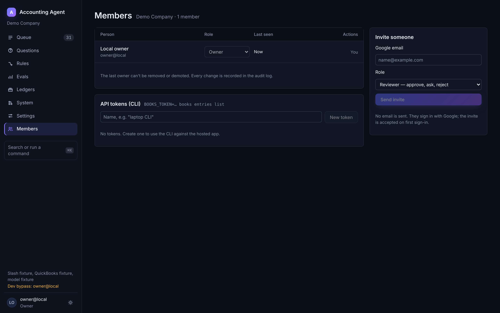

# Accounting Agent

An AI agent that does the bookkeeping grunt work: it codes bank and card transactions to the right accounts, shows its reasoning, asks when it isn't sure, and learns your rules. A person approves every entry.


```bash
pnpm i && pnpm db:reset && pnpm db:seed && pnpm dev
```

Open http://localhost:5173. It runs on built-in demo data: no accounts or API keys needed, and you're signed in as the owner.

## What it does

- **Codes transactions.** Pulls from your ledgers (Slash, Mercury) and picks the QuickBooks account for each one, including multi-line splits for marketplace payouts.
- **Shows its work.** Every recommendation comes with a confidence level, a one-line reason, and the evidence it used.
- **Asks instead of guessing.** Ambiguous purchases, transfers between your own accounts and payments to people go to the owner as a plain question.
- **Learns.** After three consistent approvals it proposes a rule, so that merchant never needs a model call again.

## How it works



Cheap, deterministic rules run first; the model is called only when they can't decide, and its answer is checked by code before you see it.

| Approve, with undo | The agent asks when unsure | See and switch every agent |
|---|---|---|
|  |  |  |

| Entry: reasoning and evidence | Evals and cost | Team and roles |
|---|---|---|
|  |  |  |

## Why it's built this way

- **A human decides.** Nothing reaches the books without a recorded approval; every write is audited.
- **Tested like software.** The model steps have eval cases (must-pass, edge and must-refuse) that run in CI.
- **Safe for more than one company.** Each company's data is isolated in the database itself (Postgres row-level security), with owner, reviewer and viewer roles.
- **Costs cents.** Rules and caching handle the routine; a typical recommendation costs a fraction of a cent.

## Under the hood

SvelteKit and TypeScript, Postgres (Neon) with Drizzle, Claude through the Anthropic API, hosted on Fly.io. One command registry drives the web UI, the `books` CLI and the ⌘K palette.

- [ARCHITECTURE.md](ARCHITECTURE.md): system design, data model, sequence diagrams, performance numbers
- [docs/setup.md](docs/setup.md): connecting real ledgers, QuickBooks and models; all commands
- [docs/design/brief.md](docs/design/brief.md): design principles and tokens

A hosted demo runs at https://laceluxx-books.fly.dev (Google sign-in, invite only).
